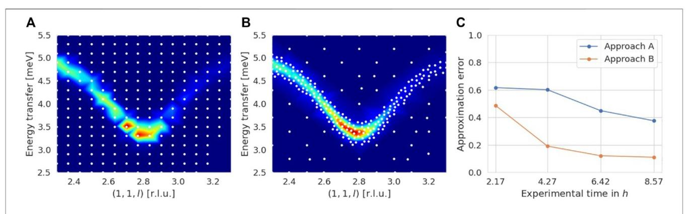

## Benchmarking Autonomous Scattering Experiments Illustrated on TAS

Mario Teixeira Parente1\*, Astrid Schneidewind1, Georg Brandl1, Christian Franz1, Marcus Noack2, Martin Boehm3 and Marina Ganeva1

1Jülich Centre for Neutron Science (JCNS) at Heinz Maier-Leibnitz Zentrum (MLZ), Forschungszentrum Jülich GmbH, Garching, Germany, 2Center for Advanced Mathematics for Energy Research Applications (CAMERA), Lawrence Berkeley National Laboratory, Berkeley, CA, United States, 3Institut Laue-Langevin, Grenoble, France

With the advancement of artificial intelligence and machine learning methods, autonomous approaches are recognized to have great potential for performing more efficient scattering experiments. In our view, it is crucial for such approaches to provide thorough evidence about respective performance improvements in order to increase acceptance within a scientific community. Therefore, we propose a benchmarking procedure designed as a cost-benefit analysis that is applicable to any scattering method sequentially collecting data during an experiment. For a given approach, the performance assessment is based on how much benefit, given a certain cost budget, it is able to acquire in predefined test cases. Different approaches thus get a chance for comparison and can make their advantages explicit and visible. Key components of the procedure, i.e., cost measures, benefit measures, and test cases, are made precise for the setting of three-axes spectrometry (TAS) as an illustration. Finally, we discuss neglected aspects and possible extensions for the TAS setting and comment on the procedure's applicability to other scattering methods. A Python implementation of the procedure to simplify its

Keywords: autonomous experiment, data-driven analysis, cost-benefit analysis, performance, three-axes spectrometry, inelastic neutron scattering, materials analysis

utilization by interested researchers from the field is also provided.

1

#### **OPEN ACCESS**

#### Edited by:

Mathieu Doucet, Oak Ridge National Laboratory, United States

#### Reviewed by:

Stephan Haas,
University of Southern California,
United States
Yao Wang,
Clemson University, United States
Vivek Dixit,
Clemson University, United States, in
collaboration with reviewer YW
Esther Tsai,
Brookhaven National Laboratory
(DOE), United States

### \*Correspondence:

Mario Teixeira Parente m.teixeira.parente@fz-juelich.de

#### Specialty section:

This article was submitted to Computational Materials Science, a section of the journal Frontiers in Materials

Received: 07 September 2021 Accepted: 22 December 2021 Published: 08 February 2022

#### Citation:

Teixeira Parente M, Schneidewind A, Brandl G, Franz C, Noack M, Boehm M and Ganeva M (2022) Benchmarking Autonomous Scattering Experiments Illustrated on TAS. Front. Mater. 8:772014. doi: 10.3389/fmats.2021.772014

#### 1 INTRODUCTION

Scattering experiments have so far been carried out in a manual or semi-automated way, i.e., experimenters had to organize the measuring process and determine what and where to measure (next). With the rise of artificial intelligence and machine learning techniques, it is natural to ask whether there are autonomous approaches that allow performing experiments in a more efficient way. In other words, it is worthwhile to see if, for a fixed cost budget like experimental time available, autonomous approaches can perform "better" experiments. In the following, by "autonomous approach" and related phrases, we refer to a decision-making algorithm that is combined with an automated communication and analysis infrastructure to create a closed loop with an instrument control system and thus is, after initialization, able to conduct measurements without human intervention.

Indeed, there are already autonomous approaches that have recently been developed for scattering experiments (Noack et al., 2020; Durant et al., 2021a; Durant et al., 2021b; Maffettone et al., 2021; Noack et al., 2021; Teixeira Parente et al., 2021). A way to compare and assess the performance of

different approaches (manual as well as autonomous approaches) is, however, currently lacking. From our perspective, benchmarking and measuring performance is of the utmost importance at this stage for the establishment and progress of autonomous approaches in the field of materials analysis by scattering methods. As examples, similar efforts already developed a benchmark for oxygen evolution reaction catalyst discovery (Rohr et al., 2020) or evaluated the performance of Bayesian optimization (Frazier and Wang, 2016) across several materials science domains (Liang et al., 2021).

In this work, we propose a benchmarking procedure which is designed as a cost-benefit analysis and can be applied to any scattering method sequentially collecting data of a certain quantity of interest during an experiment. Key components of the procedure that mainly drive the performance assessment are cost measures, benefit measures, and test cases. Cost measures specify the type of cost that is to be minimized and benefit measures characterize how "success" is defined. Test cases describe particular scenarios depending on the scattering method and determine which aspects the approaches are tested on. We emphasize that benchmarking processes in the general field of machine learning are potentially fragile (Dehghani et al., 2021) and therefore need to be defined carefully. After the general formulation of the procedure, all of the mentioned components are made precise for the setting of three-axes spectrometry (TAS).

TAS is an established technique for materials analysis by inelastic neutron scattering (Shirane et al., 2002). For decades, three-axes spectrometers have measured the dynamic properties of solids, e.g., phonons and magnetic excitations, for a wide range in both energy transfer (E) and momentum  $(\mathbf{Q})$  space and provide the opportunity to detect weak signals with high resolution. Compared to techniques like time-of-flight spectroscopy (TOF), profiting from large detector assemblies, the sequential, point-by-point, measurements in TAS experiments come with the cost of moving the three instrument axes-around a monochromator, a sample, and an analyzer-individually in real space, which is rather slow (seconds to minutes). Furthermore, instead of operating classically with a single detector, recent developments attempt to use multi-detectors for higher data acquisition speed at the expense of reduced measuring flexibility (Kempa et al., 2006; Lim et al., 2015; Groitl et al., 2016; Groitl et al., 2017). However, as a first step, we concentrate on classical TAS experiments with a single detector here.

Semi-automated TAS experiments are often systematically organized on a grid in Q-E space with predefined steps. This procedure is frequently inefficient as it collects a substantial amount of measurement points in the background, i.e., areas with erroneous signals most often coming from undesired scattering events inside the sample itself, the sample environment, or components of the instrument. If autonomous approaches, however, were able to collect information on intensities in signal regions and their shape faster, they could enable a more efficient (manual or autonomous) assessment of the investigated system's behaviour.

**TABLE 1** Result of a benchmark. Each row, representing an experiment  $\mathcal{A}=\mathcal{A}^{(\ell)}$  for a test case  $t^{(\ell)}$ , consists of benefit values (measured with  $\mu=\mu^{(\ell)}$ ) that can be achieved using milestone values  $C_m^{(\ell)}$  in column m as cost budgets.

| t (1)        | $\mu(\mathcal{A}_{J_1^{(1)}})$   |     | $\mu(\mathcal{A}_{J_{M^{(1)}}^{(1)}})$ |
|-------------------------|----------------------------------|-----|----------------------------------------|
| :                       |                                  |     |                                        |
| <i>t</i> (L) | $\mu(\mathcal{A}_{J_{i}^{(L)}})$ | ••• | $\mu(\mathcal{A}_{J_{M^{(L)}}^{(L)}})$ |

The manuscript is divided into sections as follows. Section 2 gives fundamental definitions of the key components. The benchmarking procedure is specified in Section 3 and Section 4 contains an illustration of the key components in a TAS setting. Finally, we provide a discussion in Section 5 and a conclusion in Section 6.

#### 2 DEFINITIONS

This section provides definitions for the central components of the benchmarking procedure (Section 3), i.e., for test cases, experiments, cost measures, and benefit measures. For TAS experiments, these notions are made precise in Section 4.

**Definition** (Test case). A *test case t* is a collection of details necessary to conduct a certain scattering experiment.

Here, a scattering experiment is viewed as a sequential collection of data points the meaning of which depends on the particular scattering method. Recall that an N-tuple,  $N \in \mathbb{N}$ , is a finite ordered list of N elements.

**Definition** (*t*-Experiment). Let *t* be a test case. A *t*-experiment  $A = A_t$  is an *N*-tuple of data points

$$A = (z_1, \ldots, z_N), \tag{1}$$

where  $z_j$  denote data points and  $|A| := N \in \mathbb{N}$  is the number of data points.

In order to measure costs and benefits of experiments in the context of a certain test case, we need a formalization of cost and benefit measures.

**Definition** (Cost/Benefit measure). Let t be a test case. Both, a cost measure  $c = c_t$  and a benefit measure  $\mu = \mu_t$ , are real-valued functions of t-experiments A.

## 3 BENCHMARKING PROCEDURE

In this section, we use the notions from **Section 2** to formulate the main outcome of this manuscript and suggest a step-by-step procedure for benchmarking scattering experiments. The result of a benchmark is a collection of sequences with benefit values (cf. **Table 1**) allowing to evaluate the performance of experiments in the context of predefined test cases.

Benchmarking procedure:

- 1) Specify  $L \in \mathbb{N}$  test cases  $t^{(\ell)}$ ,  $\ell = 1, \ldots, L$ .
- 2) Specify a cost measure c and define  $c^{(\ell)} := c_{t^{(\ell)}}$ .
- 3) Specify a benefit measure  $\mu$  and define  $\mu^{(\ell)} := \mu_{t^{(\ell)}}$ .

**FIGURE 1** Example for an outcome of our benchmarking procedure. Two approaches [in **(A)** and **(B)**] perform an experiment in the context of a test case including an intensity function of a phonon defined on  $\mathcal{X} = [2.3, 3.3] \times [2.5, 5.5]$ . In **(C)**, the benchmark result for this test case shows that approach **(B)** is able to reduce the approximation error from **Section 4.3** quicker than approach **(A)** since it puts the majority of measurement points in the region of signal.

For each test case  $t^{(\ell)}$ , perform the following steps:

4) Specify  $M^{(\ell)} \in \mathbb{N}$  ascending "milestone values"

$$0 < C_1^{(\ell)} < \dots < C_m^{(\ell)} < \dots < C_{M^{(\ell)}}^{(\ell)} < \infty.$$
 (2)

5) Conduct a  $t^{(\ell)}$ -experiment  $\mathcal{A}^{(\ell)} := \mathcal{A}_{t^{(\ell)}} = (z_1^{(\ell)}, \dots, z_{|\mathcal{A}^{(\ell)}|}^{(\ell)})$  such that

$$c^{(\ell)}\left(\mathcal{A}^{(\ell)}\right) \ge C_{M^{(\ell)}}^{(\ell)}.\tag{3}$$

6) For  $J \in \{1, ..., |\mathcal{A}^{(\ell)}|\}$ , let

$$\mathcal{A}_{J}^{(\ell)} := \left( z_1^{(\ell)}, \dots, z_J^{(\ell)} \right) \tag{4}$$

be the collection of the first J data points in  $\mathcal{A}^{(\ell)}$ . In particular,  $|\mathcal{A}_{I}^{(\ell)}| = J$ . Furthermore, let

$$J^{(\ell)}(C) := \max\{ J \in \{1, \dots, |\mathcal{A}^{(\ell)}|\} \mid c^{(\ell)} \left(\mathcal{A}_J^{(\ell)}\right) \le C \}$$
 (5)

be the maximum number of first data points in  $\mathcal{A}^{(\ell)}$  possible with a cost budget  $C \in \mathbf{R}$ .

Then, for each milestone value  $C_m^{(\ell)}$ , compute benefit values using the first  $J_m^{(\ell)}:=J^{(\ell)}(C_m^{(\ell)})$  data points, i.e., compute

$$\mu^{(\ell)} \left( \mathcal{A}_{J_m^{(\ell)}}^{(\ell)} \right). \tag{6}$$

Summarizing, a benchmark requires the specification of test cases, a cost measure, a benefit measure, and a sequence of ascending milestone values for each test case. The result is a collection of sequences with benefit values (cf. **Table 1**) that can be achieved using the milestone values as cost budgets.

Using their results, different approaches can now be compared by, for example, plotting the function

$$m \mapsto \mu^{(\ell)} \left( \mathcal{A}_{J_m^{(\ell)}}^{(\ell)} \right)$$
 (7)

for each test case  $t^{(\ell)}$  and each approach. In **Section 4.4** and **Figure 1** provides a demonstration for a particular test case from

the TAS context. Also, in the context of the specified cost and benefit measure, the results could allow to make strong claims of the following kind:

"Approach A lead to better experiments in p% of all test cases compared to approaches B, C, etc."

## **4 ILLUSTRATION ON TAS**

In this section, the general formulation of the benchmarking procedure and its components is made precise for TAS experiments.

## 4.1 TAS Setting

In TAS experiments, the concept of a three-dimensional reciprocal space  $\mathbf{Q}$  is essential. For a given sample (or material), an element of  $\mathbf{Q}$  is denoted by  $\mathbf{q} = (h,k,l)^{\mathsf{T}}$ . An element of the energy transfer space E is denoted by  $\omega$ . Furthermore, we call  $(\mathbf{q},\omega)^{\mathsf{T}} \in \mathbf{R}^r$ , r=4, the  $\mathbf{Q}$ -E variables. For details, we refer to Shirane et al. (2002).

Since TAS experiments are carried out only along  $n \le r$ ,  $n \in \mathbb{N}$ , predefined directions in  $\mathbf{Q}$ -E space, we introduce *experiment* variables  $\mathbf{x} = (x_1, \dots, x_n)^{\mathsf{T}} \in \mathbf{R}^n$  and a corresponding affine transformation  $T : \mathbf{R}^n \to \mathbf{R}^r$  to  $\mathbf{Q}$ -E variables, i.e.,

$$\begin{pmatrix} \mathbf{q} \\ \omega \end{pmatrix} = W\mathbf{x} + \mathbf{b} =: T(\mathbf{x}) \tag{8}$$

for a full rank matrix  $W \in \mathbf{R}^{r \times n}$  and an *offset*  $\mathbf{b} \in \mathbf{R}^{r}$ . It follows that

$$\mathbf{x} = (W^{\mathsf{T}}W)^{-1}W^{\mathsf{T}}\left[\begin{pmatrix} \mathbf{q} \\ \omega \end{pmatrix} - \mathbf{b}\right] =: T^{-1}(\mathbf{q}, \omega)$$
(9)

for  $(\mathbf{q},\omega)^{\top} \in \mathbf{R}^r$ . Note that  $T^{-1}(T(\mathbf{x})) = \mathbf{x}$  for each  $\mathbf{x} \in \mathbf{R}^n$ , but  $T(T^{-1}(\mathbf{q},\omega)) = (\mathbf{q},\omega)^{\top}$  only for  $(\mathbf{q},\omega)^{\top} \in T(\mathbf{R}^n)$ .

Each experiment variable  $x_k$  only ranges between respective limits of investigation  $x_k^{\pm} \in \mathbf{R}$ , i.e., we have that

$$x_k^- \le x_k \le x_k^+. \tag{10}$$

The corresponding domain of interest  $\mathcal{X} \subseteq \mathbf{R}^n$  is defined as

$$\mathcal{X} := \left[ x_1^-, x_1^+ \right] \times \dots \times \left[ x_n^-, x_n^+ \right]. \tag{11}$$

The representation of a TAS instrument is divided into two structures, an *instrument configuration* and an *instrument*.

**Definition** (Instrument configuration). The tuple

$$\Pi = (sm, sc, se) \tag{12}$$

for a scan mode sm  $\in$  {"constant  $k_i$ ", "constant  $k_f$ "}, a scan constant  $(k_i \text{ or } k_f) \text{ sc} > 0$ , and a vector of scattering senses se =  $(\text{se}_{\text{mono}}, \text{se}_{\text{sample}}, \text{se}_{\text{ana}})^{\top} \in \{-1, +1\}^3 \text{ is called an } (TAS) \text{ instrument configuration.}$ 

To measure intensities at a certain point in Q-E space, a TAS instrument needs to steer its axes to six related angles. However, it is enough to regard only a subset of four angles due to dependencies.

**Definition** (Instrument). The tuple

$$Ins = (\mathbf{v}, d_{\text{mono}}, d_{\text{ana}}) \tag{13}$$

for a vector of angular velocities  $\mathbf{v} = (v_1, \dots, v_4)^{\top} \in [0, \infty)^4$ , and lattice parameters of the monochromator,  $d_{\text{mono}} > 0$ , and the analyzer,  $d_{\text{ana}} > 0$ , is called an *(TAS) instrument*.

The lattice parameters of the monochromator and the analyzer are necessary for a well-defined translation of points in **Q**-*E* space to associated angles of instrument axes. The so-called *angle map* 

$$\Psi : \operatorname{dom}(\Psi) \to [0, \pi)^4, \ (\mathbf{q}, \omega) \mapsto (\Psi_1(\mathbf{q}, \omega), \dots, \Psi_4(\mathbf{q}, \omega))^{\top}$$
(14)

is induced by a sample, its *orientation*, and an instrument Ins and its configuration  $\Pi$ . Note that angular velocities  $v_k$  are related to angles  $\Psi_k(\mathbf{q}, \omega)$ . The domain  $\operatorname{dom}(\Psi) \subseteq \mathbf{Q} \times E$  denotes the set of points in  $\mathbf{Q}$ -E space for which  $\Psi$  is well-defined, i.e., points that are reachable by the instrument Ins. Furthermore, we define

$$\mathcal{X}^* := T^{-1}(\mathrm{dom}(\mathbf{\Psi}) \cap T(\mathcal{X})) \tag{15}$$

as the set of points in  $\mathcal{X}$  such that

$$\Psi(\mathbf{x}) := \Psi(T(\mathbf{x})) \tag{16}$$

is well-defined for  $\mathbf{x} \in \mathcal{X}^*$ . The limits of investigation for the domain of interest  $\mathcal{X}$  have to be set such that  $\Psi \colon \mathcal{X}^* \to [0, \pi)^4$  becomes an *injective* function.

For a given configuration  $\Pi$  and instrument Ins, we can specify a *resolution function* (Shirane et al., 2002)

$$\varphi_{\Pi,\operatorname{Ins}} : T(\mathcal{X}^*) \to (T(\mathcal{X}^*) \to [0,\infty)),$$
 (17)

i.e., each point in  $T(\mathcal{X}^*) \subseteq \mathbf{R}^r$  gives an individual resolution function defined over  $T(\mathcal{X}^*)$ . Of course, the exact resolution function depends on additional parameters such as distances between instrument components or beam divergence allowed by collimators. However, these parameters are fixed during an experiment and hence can be omitted here. If  $\Pi$  and Ins are known from the context, we write  $\varphi = \varphi_{\Pi,\operatorname{Ins}}$ . Also, for  $\mathbf{x} \in \mathcal{X}^*$ , we define

$$\varphi_{\Pi,\operatorname{Ins}}(\mathbf{x}) := \varphi_{\Pi,\operatorname{Ins}}(T(\mathbf{x})). \tag{18}$$

A sample and its orientation induce a so-called *scattering* function  $s: T(\mathcal{X}) \to [0, \infty)$ . Again, for  $\mathbf{x} \in \mathcal{X}$ , we define

$$s(\mathbf{x}) := s(T(\mathbf{x})). \tag{19}$$

Given a resolution function  $\varphi$ , we get an associated *intensity* function  $i: \mathcal{X}^* \to [0, \infty)$  defined by a convolution of s with  $\varphi$ , i.e.,

$$i(\mathbf{x}) := (s * \varphi(\mathbf{x}))(\mathbf{x}). \tag{20}$$

For benchmarking, we assume that i can be exactly evaluated. Of course, this is not possible in real experiments due to background and statistical noise.

For our suggestion of a benefit measure (**Section 4.3**), we additionally need an *intensity threshold*  $\tau > 0$ .

The experimental time is defined as the sum of the cumulative counting time at measurement points in Q-E space and the cumulative time for moving the instrument axes. For simplicity, we assume here that the single counting time, i.e., the counting time at a single measurement point, denoted by  $T_{\rm count} \geq 0$ , is constant for each point.

Now, we can specify the notion of a TAS test case and a TAS experiment.

**Definition** (TAS test case). A tuple

$$t = (\text{sample, orientation}, W, \mathbf{b}, \mathcal{X}, \Pi, \text{Ins}, \tau, T_{\text{count}})$$
 (21)

for a sample and its orientation, an affine transformation induced by a full rank matrix  $W \in \mathbf{R}^{r \times n}$  and an offset  $\mathbf{b} \in \mathbf{R}^r$  (Eq. 8), a domain of interest  $\mathcal{X} \subseteq \mathbf{R}^n$  (Eq. 11), an instrument configuration  $\Pi$ , an instrument Ins, an intensity threshold  $\tau > 0$ , and a single counting time  $T_{\text{count}} \geq 0$  is called a *TAS test case*.

Note that a TAS test case t induces an intensity function  $i: \mathcal{X}^* \to [0, \infty)$ .

In the context of a certain test case, a TAS experiment is defined as a collection of intensities  $i(\mathbf{x})$  at locations  $\mathbf{x} \in \mathcal{X}^*$ .

**Definition** (TAS *t*-Experiment). Let *t* be a TAS test case. A *TAS t-experiment*  $A = A_t$  is an *N*-tuple of location-intensity pairs

$$A = ((\mathbf{x}_1, i_1), \dots, (\mathbf{x}_N, i_N)),$$
 (22)

where  $\mathbf{x}_j \in \mathcal{X}^*$  denote measurement locations and  $i_j = i(\mathbf{x}_j) \ge 0$  are corresponding values of the intensity function i induced by t.

## 4.2 Cost Measure

We need to align our proposition of a cost measure with the limited experimental time, which is the critical quantity in a TAS experiment. Recall that the experimental time is defined as the sum of the cumulative counting time and the cumulative time for axes movement (Section 4.1).

For the cumulative counting time, we define

$$c_{\text{count}}(\mathcal{A}) := \sum_{j=1}^{|\mathcal{A}|} T_{\text{count}} = |\mathcal{A}| \cdot T_{\text{count}},$$
 (23)

where  $T_{\text{count}} \ge 0$  denotes the constant single counting time.

The cost measure representing the cumulative time for moving the instrument axes is defined as

$$c_{\text{axes}}(\mathcal{A}) := \sum_{j=1}^{|\mathcal{A}|-1} d(\mathbf{x}_j, \mathbf{x}_{j+1})$$
 (24)

for a metric  $d: \mathcal{X}^* \times \mathcal{X}^* \to [0, \infty)$ . The metric  $d = d_t$  measures the maximum time of axes movement between corresponding angles, i.e.,

$$d(\mathbf{x}, \mathbf{x}') = \max_{1 \le k \le 4} \left| \frac{\Psi_k(\mathbf{x}) - \Psi_k(\mathbf{x}')}{\nu_k} \right|, \tag{25}$$

where  $\Psi = (\Psi_1, \dots, \Psi_4)^{\mathsf{T}}$  denotes the angle map from Eq. 14 and  $\mathbf{v} = (v_1, \dots, v_4)^{\mathsf{T}}$  is the vector of the instrument's angular velocities (Eq. 13). Note that the metric d is fully determined by the TAS test case t. Also, it is indeed a metric (Encyclopedia of Mathematics, 1999) since the angle map  $\Psi$  was chosen to be injective.

The measures  $c_{\text{count}}$  and  $c_{\text{axes}}$  can be used either individually or additively to form a cost measure representing the entire experimental time. For the latter, we finally define

$$c(A) := c_{\text{count}}(A) + c_{\text{axes}}(A). \tag{26}$$

In our opinion, this cost measure is the most suitable to reflect time costs in a general TAS experiment.

#### 4.3 Benefit Measure

We propose a benefit measure that measures a type of weighted  $L^2$  approximation error between a benchmark intensity function  $i=i_t$  and an approximation  $\hat{i}=\hat{i}(\mathcal{A})$  resulting from an experiment  $\mathcal{A}=\mathcal{A}_t$ . For example,  $\hat{i}$  can be constructed with location-intensity pairs from  $\mathcal{A}$  by linear interpolation or other approximation methods. To compare benefit values across experiments relating to different test cases, benefit measures should be "normalized", i.e., we regard *relative* errors.

Let us define

$$\mu(\mathcal{A}) := \frac{\|i - \hat{i}(\mathcal{A})\|}{\|i\|},\tag{27}$$

where  $\|\cdot\|$  is a norm that enables to control the error measurement. Note that the notion of a "benefit" refers to an "error" in this case, i.e., *reducing* the benefit measure  $\mu = \mu_t$  leads to an *increase* in benefit.

A suitable error norm  $\|\cdot\|$  needs to reflect that a TAS experimenter is more interested in regions of signal than in the background. This suggests that we use i itself in a suitable definition. However, an important constraint is that signal regions with different intensities are weighted equally since they might be equally interesting. For this, we use the intensity threshold  $\tau > 0$  from the TAS test case t (Eq. 21) and define

$$i_{\tau}(\mathbf{x}) := \min\{i(\mathbf{x}), \tau\} \ge 0 \tag{28}$$

for  $\mathbf{x} \in \mathcal{X}^*$ , i.e., we cut i to a maximum intensity value of  $\tau$ . As  $i_{\tau}$  is a nonnegative function, its normalization

$$\rho_{i,\tau}(\mathbf{x}) := \frac{i_{\tau}(\mathbf{x})}{\int_{\mathcal{X}^*} i_{\tau}(\mathbf{x}') \, \mathrm{d}\mathbf{x}'}$$
(29)

is a probability density function and can be used for weighting. Finally, we set

$$\|\cdot\| = \|\cdot\|_{i,\tau} := \|\cdot\|_{L^2(\mathcal{X}^*,\rho_{\tau_n})},\tag{30}$$

where

$$\|h\|_{L^{2}\left(\mathcal{X}^{*},\rho\right)} = \left(\int_{\mathcal{X}^{*}} h(\mathbf{x})^{2} \rho(\mathbf{x}) d\mathbf{x}\right)^{1/2}$$
(31)

for a function h and a density function  $\rho$ . Note that  $\|\cdot\|_{L^2(\mathcal{X}^*,\rho)}$  can be approximated by numerical quadrature rules or estimated by a Monte Carlo approach.

#### 4.4 Test Cases

A useful set of test cases represents the variety of different scenarios that can occur in a TAS experiment. It is the set of intensity functions that is particularly important here. Therefore, we suggest to create test cases such that the corresponding induced intensity functions are composed of one or more of the following structures known in the field:

- non-dispersive structures (e.g., crystal field excitations),
- dispersive structures (e.g., spin waves or acoustic phonons),
- (pseudo-)continua (e.g., spinons or excitations in frustrated magnets).

Particular intensity functions can be created by mathematical expressions, physical simulations, or experimental data.

As an example for an outcome of our benchmarking procedure, **Figure 1** displays a comparative benchmark result of two approaches for a test case including an intensity function that reflects a soft mode of the ferroelectric phase transition at ~ 60 K of a transverse optical phonon measured on SnTe (Weber and Heid, 2021).

This figure contains exemplifications of each benchmark component: experimental time (x-axis in Figure 1C) as cost measure (Section 4.2), approximation error (y-axis in Figure 1C) as benefit measure (Section 4.3), a phonon-type intensity function (Figures 1A,B) as part of the test case (Section 4.4), and milestone values (ticks on x-axis in Figure 1C).

## **5 DISCUSSION**

In this section, we discuss some open aspects of the TAS setting from **Section 4** and the applicability of the benchmarking procedure from **Section 3** to other scattering methods. Finally, we refer to a repository containing a software implementation.

## 5.1 Neglected Aspects and Possible Extensions for TAS

The TAS setting does not comprise each detail occurring in a real experiment. Indeed, we neglected some aspects which we, however, see as acceptable deviations.

Certainly the most prominent neglected aspect is background and statistical noise. We find it difficult to include them in the benchmarking procedure due to their non-deterministic nature since a comparison of approaches needs to be done in a deterministic setting. The benefit measure from **Section 4.3**, for instance, makes use of a "true" benchmark intensity function which would not be available in the presence of background or statistical noise.

We assumed that the single counting time is constant for each measurement point. However, since single counting times are determined by the physics of the sample and the requested statistics in real experiments, they might vary at different measurement locations. In our opinion, this variation is negligible in a first step, but can be taken into account in more complex benchmarking setups if desired.

Next, the cost measures from **Section 4.2** are rather general and can be applied to any TAS instrument. They can, however, be arbitrarily extended by more details if benchmarking is to be done in the context of a specific instrument. For example, real TAS instruments may differ in more [PANDA (Schneidewind and Čermák, 2015)] or less [ThALES (Boehm et al., 2015)] time-consuming procedures for moving  $k_i$  values.

Furthermore, the intensity functions induced by the test cases described in **Section 4.4** are derived in the context of *fixed* environmental parameters of the sample (such as temperature, external magnetic or electric field, etc.). Future work might extend the four-dimensional **Q**-E space with these parameters, i.e., r > 4, to allow for more complex intensity functions that would, however, require adjusted cost measures.

Finally, to compute all benefit values for **Table 1**, the benchmarking procedure requires an approach to perform an experiment that is large enough (**Eq. 3**). Hence, an autonomous stopping criterion is not tested although we consider it a crucial part of a fully autonomous approach.

# 5.2 Applicability to Other Scattering Methods

The benchmarking procedure is formulated in a modular way and depends only on abstract components like cost measures, benefit measures, and test cases. For TAS experiments, we specified these components in **Section 4**, but feel that the overall procedure is also applicable for scattering methods other than TAS such as diffraction, reflectivity, SAS/GISAS, or TOF. Indeed, experimenters for each of these methods measure costs and benefits in their own way and investigate different kinds of intensity functions.

Diffraction experiments (Sivia, 2011), for example, may have a setting similar to TAS experiments as the experimenter is interested in intensities defined over **Q** variables and many diffractometers need to move their components (sample, detector). Therefore, the cost and benefit measures presented above might also be useful in this context. The set of test cases, however, would need to be composed differently since regions of signal are mainly separated and small in shape. Also, additional aspects (such as

shadowing, overlapping reflections, missing knowledge of symmetry, etc.) are to be taken into account.

## 5.3 Data Repository

Since the benchmarking procedure has algorithmic structure, we decided to provide an implementation in the form of Python code that computes sequences of benefit values for given cost and benefit measures (cf. **Table 1**). Also, benchmark components for the TAS setting are already implemented. The repository along with instructions on how to run the code is publicly available (Teixeira Parente and Brandl, 2021). It also contains descriptions of test cases that can be complemented in the future.

#### 6 CONCLUSION

In this manuscript, we have developed a benchmarking procedure for scattering experiments which is designed as a cost-benefit analysis and based on key components like cost measures, benefit measures, and test cases.

Although we have provided first suggestions for all these components in a TAS setting, the process of finding a suitable benchmark setting for the scattering community in general as well as the TAS community in particular is certainly not finished.

As an outlook for the TAS community, a useful next step could be the inclusion of non-constant single counting times since it has the potential of further savings of experimental time that we do not account for in the current setting. Also, extending the **Q**-E variables with environmental parameters that were assumed to be fixed would lead to a more comprehensive setting. Finally, we see the contribution to the dynamical set of test cases as another future task for the community.

## DATA AVAILABILITY STATEMENT

The datasets presented in this study can be found in online repositories. The names of the repository/repositories and accession number(s) can be found below: https://jugit.fz-juelich.de/ainx/base.

#### **AUTHOR CONTRIBUTIONS**

MG and MTP contributed to the conception and design of the study. All authors took over the implementation of the study. MTP wrote the first draft of the manuscript. CF, MG, MN, AS, and MTP wrote paragraphs of the manuscript. All authors contributed to manuscript revision, read, and approved the submitted version. GB and MTP wrote source code for implementing the benchmarking procedure.

#### **FUNDING**

MG and MTP received support through the project Artificial Intelligence for Neutron and X-Ray Scattering (AINX) funded by

the Helmholtz AI unit of the German Helmholtz Association. MN is funded through the Center for Advanced Mathematics for Energy Research Applications (CAMERA), which is jointly funded by the Advanced Scientific Computing Research (ASCR) and Basic Energy Sciences (BES) within the Department of Energy's Office of Science, under Contract No. DE-AC02-05CH11231.

#### REFERENCES

- Boehm, M., Steffens, P., Kulda, J., Klicpera, M., Roux, S., Courtois, P., et al. (2015). ThALES – Three Axis Low Energy Spectroscopy for Highly Correlated Electron Systems. *Neutron News* 26, 18–21. doi:10.1080/10448632.2015.1057050
- Dehghani, M., Tay, Y., Gritsenko, A. A., Zhao, Z., Houlsby, N., Diaz, F., et al. (2021). The Benchmark Lottery. arXiv. arXiv preprint arXiv:2107.07002.
- Durant, J. H., Wilkins, L., Butler, K., and Cooper, J. F. K. (2021). Determining the Maximum Information Gain and Optimizing Experimental Design in Neutron Reflectometry Using the Fisher Information. J. Appl. Cryst. 54, 1100–1110. doi:10.1107/S160057672100563X
- Durant, J. H., Wilkins, L., and Cooper, J. F. (2021). Optimising Experimental Design in Neutron Reflectometry. arXiv. arXiv preprint arXiv:2108.05605.
- Encyclopedia of Mathematics (1999). Metric. Encyclopedia of Mathematics. Available at: https://encyclopediaofmath.org/wiki/Metric (Accessed 06, 202130).
- Frazier, P. I., and Wang, J. (2016). Bayesian Optimization for Materials designInformation Science for Materials Discovery and Design. New York, United States: Springer, 45–75. doi:10.1007/978-3-319-23871-5\_3
- Groitl, F., Graf, D., Birk, J. O., Markó, M., Bartkowiak, M., Filges, U., et al. (2016).
  CAMEA—A Novel Multiplexing Analyzer for Neutron Spectroscopy. Rev. Scientific Instr. 87, 035109. doi:10.1063/1.4943208
- Groitl, F., Toft-Petersen, R., Quintero-Castro, D. L., Meng, S., Lu, Z., Huesges, Z., et al. (2017). MultiFLEXX the New Multi-Analyzer at the Cold Triple-axis Spectrometer FLEXX. Scientific Rep. 7, 1–12. doi:10.1038/s41598-017-14046-z
- Kempa, M., Janousova, B., Saroun, J., Flores, P., Boehm, M., Demmel, F., et al. (2006). The FlatCone Multianalyzer Setup for ILL's Three-axis Spectrometers. *Physica B: Condensed Matter* 385, 1080–1082. doi:10.1016/j.physb.2006.05.371
- Liang, Q., Gongora, A. E., Ren, Z., Tiihonen, A., Liu, Z., Sun, S., et al. (2021). Benchmarking the Performance of Bayesian Optimization across Multiple Experimental Materials Science Domains. npj Comput. Mater. 7, 188. doi:10.1038/s41524-021-00656-9
- Lim, J., Siemensmeyer, K., Čermák, P., Lake, B., Schneidewind, A., and Inosov, D. (2015). BAMBUS: a New Inelastic Multiplexed Neutron Spectrometer for PANDA. J. Phys. Conf. Ser. 592, 012145. doi:10.1088/1742-6596/592/1/012145
- Maffettone, P. M., Banko, L., Cui, P., Lysogorskiy, Y., Little, M. A., Olds, D., et al. (2021). Crystallography Companion Agent for High-Throughput Materials Discovery. Nat. Comput. Sci. 1, 290–297. doi:10.1038/s43588-021-00059-2
- Noack, M. M., Doerk, G. S., Li, R., Streit, J. K., Vaia, R. A., and Yager, K. G. (2020).
  Autonomous Materials Discovery Driven by Gaussian Process Regression with

## **ACKNOWLEDGMENTS**

We thank Frank Weber and Rolf Heid (both Institute for Quantum Materials and Technologies, Karlsruhe Institute of Technology) for providing scattering data for **Figure 1**. Also, we acknowledge discussions with Thomas Kluge (Helmholtz-Zentrum Dresden-Rossendorf).

- Inhomogeneous Measurement Noise and Anisotropic Kernels. Scientific Rep. 10, 17663. doi:10.1038/s41598-020-74394-1
- Noack, M. M., Zwart, P. H., Ushizima, D. M., Fukuto, M., Yager, K. G., Elbert, K. C., et al. (2021). Gaussian Processes for Autonomous Data Acquisition at Large-Scale Synchrotron and Neutron Facilities. *Nat. Rev. Phys.* 3 (10), 685–697. doi:10.1038/s42254-021-00345-y
- Teixeira Parente, M., and Brandl, G. (2021). BASE: Benchmarking Autonomous Scattering Experiments. Available at: https://jugit.fz-juelich.de/ainx/base.
- Teixeira Parente, M., Brandl, G., Franz, C., Schneidewind, A., and Ganeva, M. (2021). Autonomous Experiments for Neutron Three-axis Spectrometers (TAS) with Log-Gaussian Processes. arXiv. arXiv preprint arXiv:2105.07716.
- Rohr, B., Stein, H. S., Guevarra, D., Wang, Y., Haber, J. A., Aykol, M., et al. (2020). Benchmarking the Acceleration of Materials Discovery by Sequential Learning. *Chem. Sci.* 11, 2696–2706. doi:10.1039/C9SC05999G
- Schneidewind, A., and Čermák, P. (2015). Cold Three Axes Spectrometer. J. large-scale Res. Facil. JLSRF 1, A12. doi:10.17815/jlsrf-1-35
- Shirane, G., Shapiro, S. M., and Tranquada, J. M. (2002). Neutron Scattering with a Triple-axis Spectrometer: Basic Techniques. Cambridge, United Kingdom: Cambridge University Press. doi:10.1017/CBO9780511534881
- Sivia, D. S. (2011). Elementary Scattering Theory: For X-ray and Neutron Users. Oxford, United Kingdom: Oxford University Press. doi:10.1093/acprof:oso/9780199228676.001.0001
- Weber, F., and Heid, R. (2021). Private Communication.

**Conflict of Interest:** The authors declare that the research was conducted in the absence of any commercial or financial relationships that could be construed as a potential conflict of interest.

**Publisher's Note:** All claims expressed in this article are solely those of the authors and do not necessarily represent those of their affiliated organizations, or those of the publisher, the editors and the reviewers. Any product that may be evaluated in this article, or claim that may be made by its manufacturer, is not guaranteed or endorsed by the publisher.

Copyright © 2022 Teixeira Parente, Schneidewind, Brandl, Franz, Noack, Boehm and Ganeva. This is an open-access article distributed under the terms of the Creative Commons Attribution License (CC BY). The use, distribution or reproduction in other forums is permitted, provided the original author(s) and the copyright owner(s) are credited and that the original publication in this journal is cited, in accordance with accepted academic practice. No use, distribution or reproduction is permitted which does not comply with these terms.