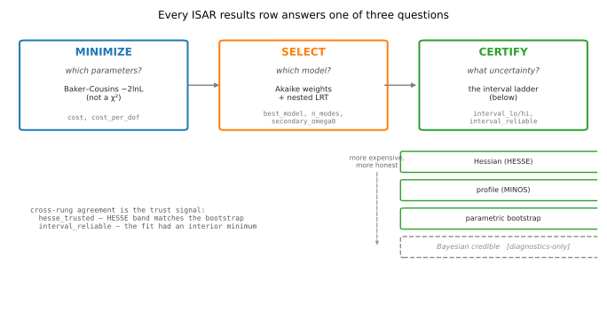
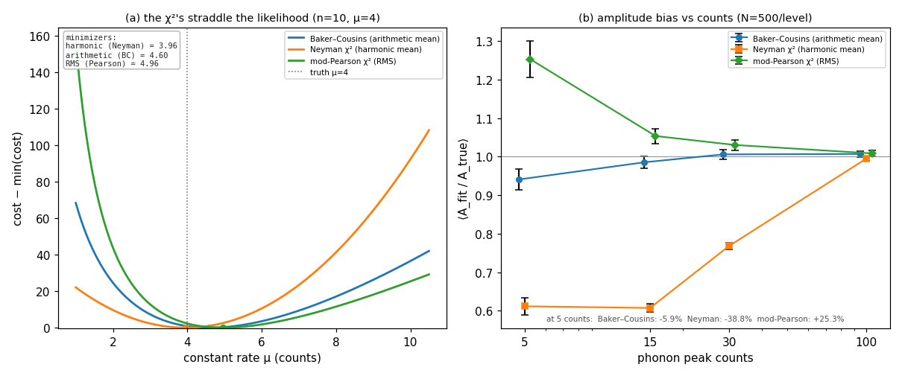
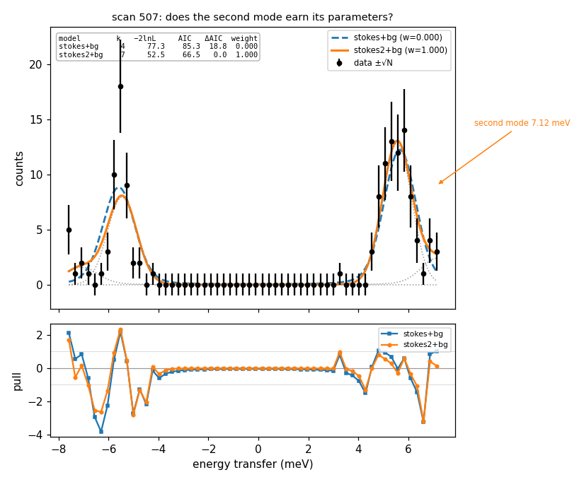
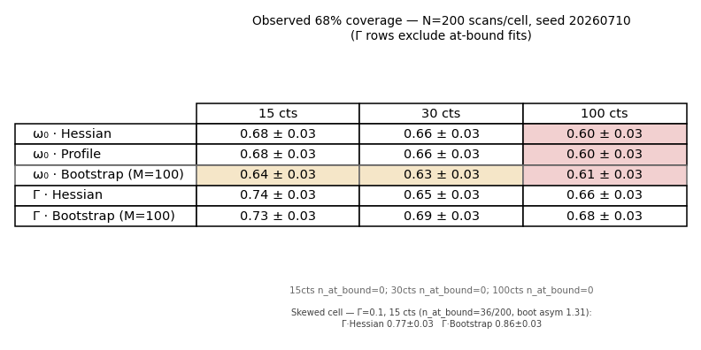
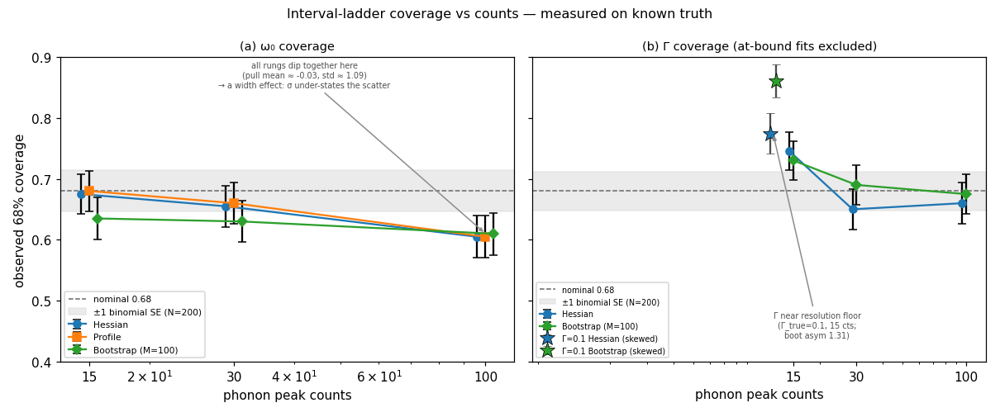
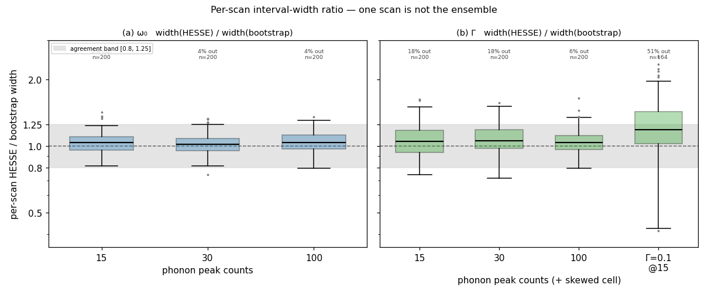
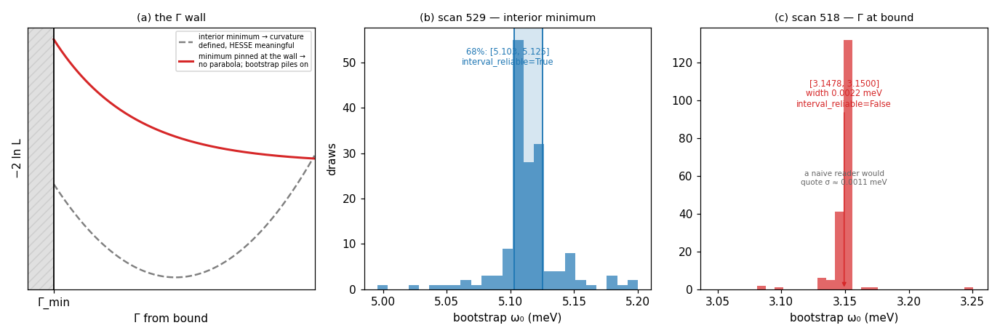
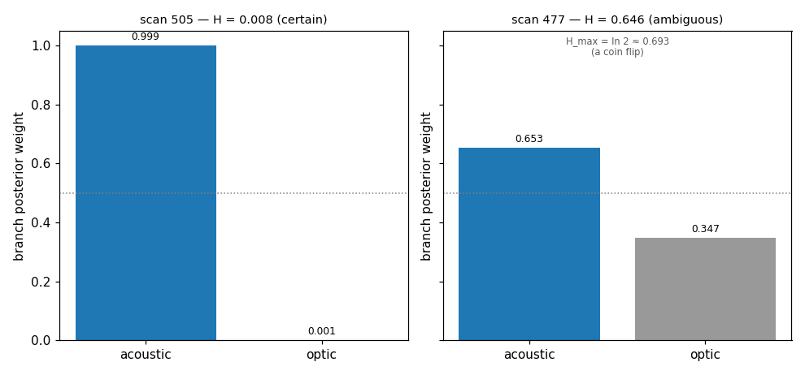

# The statistics behind an ISAR results row

> **Status:** live
> **Authority:** canonical for statistical methods; §7 is the sole record of the 2026-07-19 audit
> **Verified against code revision:** `1310969` (2026-07-30)
> **Role:** the statistics design doc (design/-equivalent; kept at this path because frozen evidence reports cite it)

*For physicists who fit by hand — and who will check.*

Every fitted number ISAR reports answers one of three questions. **Minimize:** given a model,
which parameters do the counts support? ISAR minimizes the Baker–Cousins Poisson likelihood
rather than a χ², because at triage-level counts the standard χ² choices are not approximately
right — they are measurably biased, in opposite directions, by an exact identity (Fig. 2).
**Select:** which model? A posterior over structures from per-candidate Bayesian evidence
(Laplace, with escalation to nested sampling), Akaike weights persisting as a recorded
diagnostic, and a fork reported when the data genuinely cannot decide (Fig. 3).
**Certify:** what uncertainty? A ladder of intervals — Hessian, profile,
parametric bootstrap — whose 68% coverage we measured on known truth rather than assumed
(Figs. 4–6), together with explicit flags for the regime where every rung fails at once (Fig. 7).

None of this is asked on faith. Every figure here is generated by one seeded script,
[docs/stats/make_figures.py](stats/make_figures.py) (SEED = 20260710), against either synthetic
ensembles or the archived workspace `mvp_zone_test16`, and every chapter ends with the exact
command that regenerates its evidence. Where a capability is not yet wired in, it is tagged
**[Planned]** — never implied.

---

## 0. Three questions, one vocabulary

Every number in a `results.csv` row answers exactly one of the three questions, and trusting a
number means trusting the machinery behind its question. Fig. 1 is the map; note the one dashed
box — the single-fit Bayesian rung of the certification ladder — which is built but **does not
certify on its own**.



**FIG. 1.** The pipeline map: minimize → select → certify. Generated by
`docs/stats/make_figures.py` (no data inputs).

One founding priority explains this document's proportions: **error estimation is the spine,
not one of four ribs**. The uncertainty is what the human acts on, what computed confidence is
built from, and — the part that matters most — the entire input to autonomous steering ("put
beam where the error is too big"). A wrong error bar does not just mislabel one scan; it
misdirects every future-measurement decision built on top of it. That is why certification gets
the largest share of the machinery, and why its calibration is measured rather than assumed
(§3).

Vocabulary is discipline, not pedagogy, in this document:

> - **Bootstrap** means *frequentist-by-simulation*: refit many Poisson redraws of the best-fit
>   model and read the spread. It is not Bayesian and is never called "credible".
> - The branch-assignment weights (`branch_posterior`, `assignment_entropy`, `branch_id`) are a
>   normalized, versioned assignment-score distribution **[Implemented]**. They are probability-like
>   weights, but are not claimed to be a calibrated Bayesian posterior.
> - The dispersion-prior MAP fit (`prior_omega`, `prior_sigma` → `fit_kind=soft_prior`) is a
>   prior-regularized point estimate **[Implemented]**. It is not a stored posterior distribution
>   or a credible interval.
> - Bayesian credible **intervals** on ω₀ are **[Implemented, diagnostics-only]**: the nested
>   sampler (`isar/analyze/errors/bayes.py`) is wired through `--errors bayes` and stores
>   `bayes_interval` plus posterior samples and agreement diagnostics. A physical row never
>   certifies directly from `bayes_interval`. A pooled master's legacy model interval can,
>   however, include those nested particles in a model-dependent mixture and currently seats
>   certification; §4.1 records that distinct authority and its limitations.
> - `confidence` is a heuristic triage score, not an empirical or Bayesian probability.

### 0.1 Additive statistical-semantics contract

STAT-1 adds optional metadata without changing a fit, score, interval, verdict, stop, or action.
Full records live in `session.json`; compact projections are appended to `results.csv`; legacy
rows expose no semantics rather than inventing producer provenance. The four record schemas are
`isar.fit_selection_semantics/2` (which replaced `/1` outright when evidence selection landed —
H1/H4; `/1` records are unreadable-legacy by design), `isar.interval_semantics/1`,
`isar.probability_semantics/1`, and `isar.predictive_semantics/1`.

Every authority declaration is scoped: for example, an interval can remain active for
`legacy_master_certification` and `stopping` while being ineligible for `eig_shadow`,
`eig_authoritative`, and `acquisition_selection`. `unknown_legacy` is reader-only. If a producer
cannot construct valid metadata, it records a structured `semantics_construction_failed` warning
and publishes the otherwise-valid scientific result with semantics unavailable.

Candidate comparability is represented by four identities, not inferred from a shared model label:
the exact data/energy-grid/mask/normalization/likelihood context, model parameterization, effective
constraints, and their combined comparison context. Model-set fingerprints contain sorted
structured model/context records, so enumeration order is irrelevant, while changing a candidate
route or Akaike denominator changes the complete selection identity. The selection record publishes
its aggregate eligibility and every candidate-specific reason. STAT-2a consumes those
producer-owned classifications in a diagnostics-only shadow comparison rather than re-deriving
them; production selection enforces them for authority now, since evidence selection is the
production selector (H4) — a recorded AIC fallback lane is a named degraded mode and is
selection-ineligible for acquisition steering.

For intervals, producer capability and realized authority are separate. A bootstrap or profile
producer may offer an interval to the delivery ladder, but only the value actually selected after
reliability/trust gates, branch triage, and connected tracking carries delivery or stopping
authority. Predictive/projection semantics fingerprints are authenticated by readers. Missing
semantics remain valid legacy numerical input; present-but-modified semantics are refused under the
stable `predictive_semantics_invalid` reason.

Verify the map (no workspace needed):

```
python docs/stats/make_figures.py --only three_questions
```

## 1. Minimize: why not the χ² you already use

The default everywhere — Igor, PAN, home-grown Matlab — is least squares with σ² = data
(Neyman) or σ² = model (Pearson). At high counts both are fine. The problem at low counts is
not approximate, it is an identity: for a constant rate the three costs have exact closed-form
minimizers — the **harmonic mean** of the counts (Neyman), the **RMS** (modified Pearson), and
the **arithmetic mean** (Baker–Cousins Poisson likelihood). The two χ²'s provably straddle the
likelihood answer; Fig. 2(a) shows the three cost curves and their marked minimizers on a single
seeded Poisson draw. This is not a simulation artifact — it is what those cost functions *are*.

The measured consequence on the actual lineshape is Fig. 2(b): N = 500 synthetic phonon scans
per count level, the *same data* fit three times with only the estimator swapped. At 5 expected
peak counts Neyman pulls the fitted amplitude down by 38.8% and modified Pearson pushes it up
by 25.3%, while Baker–Cousins sits at −5.9%; all three converge by ~100 counts. If your
intuition was trained on well-counted scans this is quite a surprise — and a phonon's Γ and its
Stokes/anti-Stokes ratio are exactly the quantities these biases distort, at exactly the count
rates where triage decisions get made.



**FIG. 2.** The estimator straddle and its measured bias. Generated by
`docs/stats/make_figures.py` (seed 20260710); numbers in the text are from
`stats/figures/cost_bias.json`.

ISAR therefore minimizes the Baker–Cousins cost **[Implemented]** for every fit. In the reports,
`cost_per_dof` is this cost per degree of freedom — read it like a reduced χ²: near 1 is a good
fit, ≫ 1 means the model does not match the data.

Verify (no workspace; ~1–8 min depending on `--workers`):

```
python docs/stats/make_figures.py --only cost_bias --workers 8
```

## 2. Select: which model, decided by Bayesian evidence

Adding parameters always lowers the cost, so raw χ² (or raw likelihood) always votes for the
more flexible model, and eyeballing a shoulder is not reproducible. Since H4, ISAR decides by
**evidence**: each converged candidate gets a marginal likelihood lnZ through a validity ladder —
a Laplace approximation at the fitted optimum, a warm-started MAP refit when the fit never saw a
prior it must integrate, or dynesty nested sampling whenever a Gaussian volume cannot be trusted
(boundary-pinned parameters, failed curvature) — and selection is the posterior
**P(s) = π_s·Z_s / Σ π·Z**, uniform prior over admissible structures **[Implemented]**. The Occam
penalty is the integral itself, not a parameter tax. Evidence is comparable only within one
data-likelihood arena (the record carries the arena fingerprint; cross-arena comparison raises),
priors enter exactly once (a transported soft constraint IS its parameter's prior), and a
deferred escalation whose evidence ceiling sits ≥100 nats below a trusted leader is recorded
`dominated` instead of sampled; surviving escalations sample at n_live=128, scoped to that lane.
The escalation phase also carries a wall-clock budget per candidate set (`ESCALATION_BUDGET_S`,
a backstop against a pathological set rather than a throughput lever). A candidate the budget
skips is recorded `unresolved` with its ceiling intact — kept out of the posterior like
`dominated`, but *not* ruled out. If such a candidate's ceiling still reaches the best trusted
evidence, the comparison is incomplete rather than close, and selection degrades rather than
ranking on whichever candidates happened to be sampled.
**In plain terms**, because this paragraph earns its keep at the podium: the likelihood at the
best-fit point always improves when you add a knob, so it cannot judge between models. The
*evidence* (marginal likelihood, Z) asks a different question — not "how well does this model fit
at its best tuning?" but "how well does it fit *averaged over everything its parameters are
allowed to do*?" A model with an extra peak spreads its bets over a much larger parameter
volume; if the data does not need that peak, most of that volume fits badly and drags the
average down. That is the Occam penalty — not AIC's flat fee of 2 per parameter, but the
measured cost of the parameter volume the model wasted. The "validity ladder" is just three ways
of computing that average, cheapest first: treat the likelihood peak as a Gaussian bump and
integrate it analytically (Laplace — fine when the peak is clean); refit once with the prior in
place first when the original fit never saw it (MAP, then Laplace); and when a Gaussian bump
cannot be trusted at all — a parameter pinned at a bound, broken curvature — pay full price and
explore the volume numerically (nested sampling). Each candidate's record names which rung
produced its number. The selected structure is then simply the one holding the largest share of
the total evidence.

When evidence cannot be computed at all, or the set is incomplete in that sense, selection falls
back to AIC and *says so* — the record names the lane (`aic_no_evidence_inputs` /
`aic_all_evidence_invalid` / `evidence_budget_exhausted`), and a fallback-lane record is
ineligible to steer acquisition.

**AIC** (= cost + 2 per free parameter) and **Akaike weights** are computed and persisted per
candidate as the diagnostics lane, plus a nested likelihood-ratio test for nested pairs
**[Implemented]**. An Akaike weight is neither a Bayesian posterior model probability nor a
Bayes factor — under `/2` the two live side by side in the candidate table, and the posterior is
the one that drives. STAT-1 records estimator, effective constraints, candidate route, selection
eligibility, and each model-set transition.

STAT-2a now also records a diagnostics-only `isar.model_selection/2-shadow` comparison
**[Implemented]**. For an unconstrained complete route it reuses the exact fitted candidate objects;
when delivery constraints are effective it fits the complete standard family under the same data,
mask, normalization, likelihood, and unconstrained parameterization. The full record is persisted
in `session.json` and a compact projection is appended to `results.csv`. A finite runtime allowance
skips the shadow work with a structured reason, and any shadow failure leaves the legacy selector,
verdict, intervals, certification, stopping, cache identities, and acquisition behavior unchanged.
The current `isar.shadow_model_selection/2` schema authenticates every candidate against the
declared data-likelihood context and records whether shadow evidence was exactly reused, partly
reused, freshly fitted, skipped, or unavailable. Those execution fields are provenance, not inputs
to the standard-selection fingerprint; `/1` shadow records remain readable.
The shadow lane stays AIC-labeled by design (it measures criteria, D6); the authoritative
successor it anticipated landed as evidence selection (H4), with the diagnostics/production
separation carried by the two recorded lanes rather than a promotion ceremony.

Fig. 3 is scan 507 of the archived workspace, chosen by criterion (`n_modes==2`,
`verdict=="resolved"`, `interval_reliable`), not by eye. The one-mode fit (dashed) leaves
coherent pull-residual structure near 7 meV that the two-mode fit removes — the lower panel
carries the evidence. The second mode at 7.12 meV costs three extra parameters and buys
ΔAIC = 18.8: the Akaike weight concentrates entirely on `stokes2+bg` (w = 1.000 vs 0.000). The
second peak *earned* its parameters; nobody eyeballed a shoulder. (The figure renders the
recorded AIC diagnostics table; live selection is driven by the evidence posterior, which on a
separation this decisive agrees.)



**FIG. 3.** Model selection on scan 507 of `mvp_zone_test16`; AIC table rendered at build time
from `score_models`, never hand-typed.

**Owner direction (2026-08-20, walkthrough ruling — work tracked as TODO CAL-5): the
degenerate-limit rule.** When one candidate family contains another as a boundary case, the
honest comparison is *free-versus-pinned within the family* — "did the parameter earn its
freedom?" — never an evidence beauty contest between the free model and its own limit. Near the
boundary the two coincide, the extra parameter direction is unconstrained, and the evidence
difference measures the arbitrary prior volume of the unused parameter rather than anything in
the data. A free fit that lands on the boundary resolves to the pinned candidate. First
application: the **resolution lineshape**. Different machines have different resolution shapes
(most Gaussian, some Lorentzian, some genuinely Voigt); the elastic-line fit currently always
fits the full two-width Voigt. The candidate set becomes {Voigt(both widths free),
Gaussian(`lorentz_fwhm`=0), Lorentzian(`gauss_fwhm`=0)}, evidence selects, and the record can
honestly say "we checked the Voigt; the evidence supports the degenerate case" — without paying
for parameters the instrument doesn't use. (Same pattern as §4's delta-function ruling: the
degenerate case is a first-class candidate, not a failure mode or a silent pin.)

When two genuinely different structures fit equally well, ISAR reports a **fork** — both
answers — rather than averaging them into a single wrong number **[Implemented]**. Columns:
`best_model`, `n_modes`, `secondary_omega0`, `secondary_omega0_err`.

Verify:

```
python docs/stats/make_figures.py --only akaike --workspace <path-to-mvp_zone_test16>
```

## 3. Certify: the interval ladder, with its coverage measured

The fast error bar every tool quotes is the Hessian ("HESSE"): invert the curvature of the cost
at the minimum. It assumes the cost is a clean parabola. ISAR computes it
(`hesse_lo`/`hesse_hi`) **[Implemented]**, then climbs: a profile-likelihood (MINOS) interval,
which can be asymmetric (`omega0_profile_lo/hi`) **[Implemented]**; a parametric bootstrap —
M refits of Poisson redraws — as the ordinary physical-fit authoritative interval
(`interval_lo/hi`) **[Implemented]**; and a Bayesian credible interval as the top single-fit rung
**[Implemented, diagnostics-only]**. Pooled-master certification uses the separate mixed interval
described in §4.1.

A ladder is only worth its cost if the rungs differ measurably, so we measured them. The claim
"a 68% interval covers the truth 68% of the time" can only be tested where the truth is known,
which is why the test is synthetic by construction (this is the calibration tier of ISAR's
validation; the real-data tier tests reasonableness against a human, not calibration). What was
controlled:

- the generator is *identical* to the fitted model — deliberately. In inverse-problems terms
  this is the **inverse crime**, and it is committed on purpose: sharing the model isolates the
  optimizer and the error machinery from any model-mismatch, so a failure can only be the
  fitter's fault. The crime is then broken deliberately in the robustness tier — and the two
  stages are kept distinct, because a clean inverse-crime pass must never be mistaken for "the
  fitter works on real data" (misspecification is Chapter 6's subject);
- the truth is exact and per-scan; coverage is tallied directly against it;
- all three methods are evaluated on the **same** per-scan fits — a paired comparison, not
  three separate ensembles;
- every scan is deterministically seeded and worker-count-invariant;
- N = 200 scans per cell, so the binomial standard error at p = 0.68 is ±0.033 — wide enough
  to be honest about, quoted on every cell.



**FIG. 4.** Observed 68% coverage. All numbers copied verbatim from the committed
`stats/figures/coverage_summary.json`; nothing in this table is hand-typed.



**FIG. 5.** The same data as Fig. 4 drawn as coverage vs counts, with the skewed-Γ cell
(§3.2) marked by stars.

### 3.1 The honest headline: on ω₀, the cheap error bar holds

We expected HESSE to under-cover and the bootstrap to rescue it. That is **not** what the
experiment shows, and we report what it shows. On ω₀ the three rungs are statistically
indistinguishable at every count level — 0.68/0.68/0.64 at 15 counts, 0.66/0.66/0.63 at 30,
0.60/0.60/0.61 at 100 (Hessian/profile/bootstrap, ±0.03 each). ω₀ is a location parameter with
a nearly parabolic likelihood; the Bernstein–von Mises regime arrives early, and the HESSE
number is genuinely fine *when the fit is healthy*. (The same held in ISAR's Phase-3 method
comparison; this is a consistent result, not a one-off.)

Two things in Fig. 5 still demand explanation, and neither flatters the machinery:

**All rungs dip together at high counts.** At 100 expected peak counts every method covers at
~0.60–0.61, about 2 SE below nominal, with zero central-value bias (mean pull −0.03, bias
< 0.001 meV). The pull width tells the story: 1.01 at 15 counts → 1.09 at 100. There is a small,
count-independent scatter floor in the derived ω₀ (~0.01 meV, from the initial-condition grid,
optimizer tolerance, and the ω₀ = √(Ω_d² + Γ²) reparameterization) that no per-fit interval —
curvature, profile, or bootstrap — can see, because all three are built on the same fit. It is
negligible when σ ≈ 0.09 meV and eats ~7% of coverage when the interval tightens to
σ ≈ 0.034 meV. This is a preview of Chapter 6: an interval can only account for the
uncertainty its model contains.

**Coverage is a property of an ensemble you will never have.** The table says "68% of *200
scans*". You get *one*. An error bar that is right on average and wrong scan-to-scan is
indistinguishable, on your one scan, from an error bar that is simply right — unless you can
check it *on that scan*. That is the actual argument for the ladder, and it is Fig. 6.

### 3.2 The single-scan argument: agreement is checkable, coverage is not

Fig. 6 plots, for every scan in the ensemble, the ratio of its HESSE width to its bootstrap
width. On healthy ω₀ fits the two agree within ±25% for ~96% of scans — which is *why*
`hesse_trusted` can certify the fast tier. But push Γ toward the resolution floor
(Γ_true = 0.1 meV at 15 counts, where the bootstrap Γ interval is visibly right-skewed, median
asymmetry 1.31) and the per-scan agreement disintegrates: the median HESSE/bootstrap width
ratio rises to 1.18 and **51% of scans fall outside the agreement band** — some HESSE bars
half the bootstrap width, some double. The *ensemble* Γ coverage in that same cell still looks
respectable (0.77 vs 0.86 excluding at-bound fits) — the average hides exactly what the
experimenter needs to know about their one scan. Including the at-bound fits, HESSE Γ coverage
drops to 0.64 while the bootstrap holds 0.81: the failure concentrates in the scans the wall
chapter is about.

A concrete mis-certification, from the 2026-07-10 deterministic re-certification (log in git
history): at q=0.45 a converged scan with `interval_reliable=False` but `hesse_trusted=True`
certified the HESSE interval [3.8248, 3.8276] against a truth of 3.8967 — outside by
0.070 meV, roughly **35 half-widths**. Its γ = 0.0134 passed the at-bound heuristic, so the
trust gate (covariance_ok ∧ ¬gamma_at_bound ∧ counts) admitted it. The lesson is standing: a
covariance-based trust gate needs the same calibration scrutiny as the bootstrap flag — a γ
near but not *at* the bound can still fool it.



**FIG. 6.** Per-scan HESSE/bootstrap width ratio. One scan is not the ensemble: the skewed-Γ
cell has half its scans outside the ±25% agreement band even though its ensemble coverage
looks acceptable.

This is why ISAR's trust signals are per-scan agreement checks, not ensemble statistics:
`hesse_trusted` (does the HESSE band match the bootstrap on *this* scan) and
`interval_reliable` (did *this* fit have an interior minimum). When the rungs agree, the cheap
number was trustworthy; when they diverge, the row says so.

Verify (fast tier, ~2 min; ordering and the skewed-cell blow-up reproduce, with N = 40 noise):

```
python docs/stats/make_figures.py --only coverage --fast --workers 8
```

The primer's quoted numbers come from the committed full run (N = 200, M = 100), regenerable
with the same command minus `--fast`, or replotted without refitting via
`--only coverage --replot-from-dump`.

## 4. When the ladder breaks: the Γ wall

Every rung in Chapter 3 assumed the fit found an *interior* minimum. On a resolution-limited
spike it does not: the fitted damping Γ runs into its lower bound and stays there. At the bound
there is no parabola to invert — the HESSE σ_Γ is undefined-in-principle, whatever number the
matrix inversion returns — and the parametric bootstrap collapses, because every redraw refits
to the same wall (Fig. 7a).

Fig. 7 shows both outcomes on real archived data, re-fit standalone (M = 200 bootstrap refits,
seeded) from the workspace's archived calibration. Scan 529 is healthy: an interior Γ minimum,
a bootstrap ω₀ distribution with believable spread, 68% interval [5.103, 5.125],
`interval_reliable=True`. Scan 518 is the pathology: the distribution collapses to
[3.1478, 3.1500] — width 0.0022 meV. A naive reader would quote σ(ω₀) ≈ 0.001 meV, three
orders of magnitude tighter than the ~1 meV instrument resolution. Zero width is degeneracy,
not precision.



**FIG. 7.** The Γ-at-bound wall: schematic, healthy scan 529, degenerate scan 518, equal
x-spans. Histograms are standalone re-fits of the archived scans.

Before declaring the collapse a property of the likelihood rather than of our machinery, we
ruled out:

- optimizer failure — the fit converged (`cost_per_dof` ≈ 2.1: imperfect, as expected for a
  spike the model cannot narrow, but not pathological);
- seed dependence — the collapse persists under re-seeding;
- too few bootstrap draws — M = 200;
- conditioning by the session's prior — the figure re-fits the scan *standalone* from archived
  calibration columns only, and the script asserts the collapse (width < 0.01 meV) rather than
  assuming it, refusing to plot if the story were wrong;
- masking or binning artifacts — the raw points are in the workspace report.

One honest wrinkle from that audit: the plan for this figure originally named scan 505 as the
healthy example. Re-fit standalone, 505 collapses too — its archived healthy interval came from
a *branch-conditional* fit (`fit_kind=branch_conditional`, Γ informed by the session's branch
belief). That is not a bug; it is `fit_kind` doing its job, and it is why the healthy panel
uses scan 529, which has an interior minimum unconditionally.

ISAR's move mirrors the audit: it does not report the collapsed interval as a precision. The
row gets `interval_reliable=False` and `gamma_provisional=True`, and the delivered band falls
back to the HESSE width — not because HESSE is good here, but because a flagged, visibly
provisional band is honest where a 0.001 meV bar would be a lie. (Reporting the collapsed
interval would be the statistical equivalent of quoting C₆₆ from a dispersion slope the data
never resolves: formally computable, physically meaningless.)

**Owner direction (2026-08-20, walkthrough ruling — work tracked as TODO CAL-4):** accepting the
collapse and reporting `resolution_limited` has quietly become a mark of pride, and it should
not be — scientists route around a method's failure rather than dwelling in it. The proposed
route: make "resolution-limited" a *candidate structure* instead of a failure mode — fit a
zero-width line (a delta function, so the fitted shape is the resolution function itself) as an
admissible structure beside the finite-Γ DHO, and let §2's evidence selection decide. When the
delta wins, the honest deliverable is a positive statement — "Γ is not resolvable at this
resolution," with an upper limit — rather than a pinned-bound fit with a degenerate interval.
(The operator's previous analysis program instead pushed Γ away from the bound with a repulsive
term; recorded as the alternative considered.)

Verify:

```
python docs/stats/make_figures.py --only wall --workspace <path-to-mvp_zone_test16>
```

### 4.1 Campaign certification is a pooled, model-robust statement

A scan verdict and a campaign decision answer different questions. Individual fits are useful
diagnostics, but repeated measurements at the same `(q,T)` are one combine-before-divide Poisson
observation. Only that pooled master can certify ω or update the authoritative dispersion prior.

Before certification, ISAR checks that exposure-scaled member spectra are homogeneous with a seeded
parametric-bootstrap Poisson deviance test (default α=0.01). The test masks rather than removes bad
points and treats zero counts exactly. A failure says “this pool is internally inconsistent”; it does
not license automatic exclusion or prove the requested physics infeasible.

The certifying ω interval is taken across the retained model-weighted full-parameter predictive
ensemble, not from whichever individual scan or single fitted structure happened to look best. In
the current `isar.master_predictive/2` contract, the parameter particles are selected model by model:
nested posterior resamples first, then parametric-bootstrap draws, then a trusted HESSE/Laplace
approximation. Retained model weights (evidence posteriors since H4; the record names its
`model_weight_kind`) are fixed at their observed-data values. The resulting
`model_interval` is therefore a conditional-on-target-present, heterogeneous mixed-particle quantile;
it is neither a Bayesian model-averaged credible interval nor a bootstrap distribution of the complete
refit-and-reselect procedure. No-target mass is not included in its ω quantiles.

That interval retains active **legacy** master-certification and stopping authority so STAT-1 changes
no behavior. Its semantics explicitly make it ineligible for EIG and acquisition. The distinction
still resolves the Γ wall operationally: Γ can sit at the instrumental resolution boundary while ω
remains identifiable after mixing over retained parameter and model uncertainty. Conversely,
unresolved ω multimodality, label switching, target-track ambiguity, or pool inconsistency blocks
certification no matter how narrow one model's HESSE bar looks. Coverage and unconditional
false-certification calibration of this actual mixed delivery remain required before changing its
scientific authority.

The final-certification computation preserves that statistical unit. It refits—or exactly reuses—one
frozen pooled master per requested `(q,T)`, never the physical scans that contributed its counts.
Completed master units checkpoint immediately, but the authoritative generation is published only
when the entire objective-path worklist is complete. Thus interruption changes elapsed time, not the
sample, seed, model inputs, reduction order, or reported interval.

## 5. Bayesian and probability-like pieces

Chapter 0 separates three related outputs: normalized branch-assignment weights, a
prior-regularized MAP point estimate, and diagnostics-only nested-sampler credible intervals. A MAP
estimate is not by itself a stored posterior distribution or interval.

**The branch-assignment score distribution [Implemented].** ISAR reports `branch_id`, normalized
assignment weights in `branch_posterior`, and their Shannon entropy `assignment_entropy`. The
versioned scorer combines likelihood-like compatibility with explicit assignment rules and
penalties. The weights are useful for ranking and thresholding, but no reliability campaign or
fully normalized generative model currently earns calibrated-posterior language. Fig. 8 contrasts
scan 505 (entropy 0.008 — concentrated, weight 0.999
acoustic) with scan 477 (entropy 0.646 of a possible ln 2 ≈ 0.693 — a coin flip, 0.653 vs
0.347). The entropy *number* is the deliverable: near 0, the assignment can be banked into the
dispersion prior; near ln 2, ISAR reports the ambiguity instead of guessing a branch and
poisoning the prior with it. The figure renders the archived campaign's numbers — provenance,
not re-derivation.



**FIG. 8.** The normalized branch-assignment weights for a concentrated and an ambiguous scan of
`mvp_zone_test16`; entropy records concentration over the declared assignment state space.

**The dispersion-prior MAP point estimate [Implemented].** When the campaign has a belief about
ω₀ at a q-point, the fit can be softly constrained by it; `prior_omega`, `prior_sigma`, `prior_n`
record the regularizing prior and `fit_kind` records that it was used. The optimizer returns a MAP
point estimate, not a stored posterior distribution or credible interval. The data-only cost is
kept separate (`cost` vs `posterior_cost`), but the data cost is evaluated at the constrained
optimum. STAT-1 therefore labels effective soft constraints and unapproved hard conditioning as
selection-ineligible while retaining the legacy scores. STAT-2a now observes comparable
unconstrained selection fits beside constrained delivery fits without changing authority. Under
H4 the separation is enforced in production: evidence selection consumes transported
(prespecified-origin) priors exactly once, and `data_dependent_rescue` / `post_selection`
conditioning remains selection-ineligible.

**Nested-sampler credible intervals [Implemented, diagnostics-only].** Under `--errors bayes` the
nested sampler runs on the preliminary-best label and records `bayes_interval`,
`bayes_gamma_interval`, posterior samples, and its own
convergence gates (`bayes_ok`, `bayes_ess`, `bayes_fail_reason`). The frequentist↔Bayesian
agreement check is live as a per-scan trust signal of the §3.2 kind (`bayes_freq_ratio`).

These samples are a Bayesian posterior under an optimizer-bound, data-dependent prior kernel.
That makes the individual posterior interval a coherent conditional result under that kernel, but
its `log_evidence` is not comparable across models or campaigns, and the current system is not a
Bayesian model average. What remains **[Planned]** is the *licence*, and it splits into two different kinds of waiting:
the single-fit interval's promotion to a certifying rung needs the **coverage campaign** (TODO
CAL-2) — the scoring machinery for it exists, so that gate is owner go-ahead plus compute, with
one technical settle inside it (the `nlive` 250-vs-400 discrepancy on very-high-count scans);
whereas any formal Bayesian model-average or evidence-comparison authority needs **real design
and implementation work** (plans/stats-audit.md STAT-5): a scientific prior registry replacing
the data-dependent box kernel, prior normalization and sensitivity, all-model coverage including
the null, evidence-uncertainty propagation, SBC/PPC, and calibration. A physical row's `bayes_interval` remains
diagnostic; §4.1 separately describes the legacy mixed master interval.

Verify:

```
python docs/stats/make_figures.py --only branch --workspace <path-to-mvp_zone_test16>
```

## 6. The honest caveat: these intervals are statistical-only

This is the most important thing to know before you use an ISAR uncertainty.

ISAR's bootstrap interval captures **counting statistics only**. It does **not** include
systematic uncertainty — the background shape, the resolution function, energy-zero drift
between scans. Chapter 3 sharpens this rather than softening it: *within* its own statistical
universe the machinery is calibrated (Fig. 4), the high-count dip is itself a measured example
of uncertainty the per-fit interval cannot contain, and that is exactly why the 18%
gold-set coverage against a human's values is diagnostic of missing *systematics*, not of
broken statistics. On well-counted data the counting error is tiny, so the interval is tight;
the human's value falls inside ISAR's 68% interval far less than 68% of the time. **That is
expected from a statistical-only interval, and it means the error bars are too small to use as
final uncertainties.**

What *is* reliable is the **central value**. On the gold set ISAR's energy lands a median of
~0.16 meV from the human's — well inside the ~1 meV instrument resolution. So:

> **Practical rule:** treat ISAR's energy as a good ballpark and its confidence as triage
> guidance. Do **not** weight by ISAR's σ or quote it as a final uncertainty — measure that
> yourself once you've looked at the scan. A systematics-aware error model is future work.

This is why the reports separate **parameter recovery** (good — the number is in the right
place) from **interval calibration** (a known limitation — the *width* is statistical-only),
and why the validation runs in two tiers: synthetic truth tests calibration, real-data
comparison tests reasonableness and safety against a provisional human reference. Agreeing
*exactly* with the human was never the goal.

Verify the gold-set numbers:

```
python docs/phase3_gold_check.py
```

---

## 7. Known weak points — the 2026-07-19 statistics-contract audit

A post-MVP audit asked how ISAR decides *how long to count, what a scan tells us, and what to do
next*. Its findings are recorded here because three workstream plans are built on them, and one
shared record is better than three drifting copies.

**Verdict.** The statistical core came out better than expected: Baker–Cousins throughout, measured
interval coverage (§3), a fold-only prior gate, and an EIG acquisition that explains rather than
causes one of the reported symptoms — the "too wide" survey scans are cold-start survey mode doing
its designed job, not a defect.

Three genuine weak points, each now the subject of a plan:

| Weak point | Status | Governing plan |
|---|---|---|
| **Backgrounds are a single flat constant** — the largest real-data risk. Long elastic tails and sloped baselines under the inelastic signal silently bias phonon amplitudes | Open | `plans/background.md` |
| **Counting targets are absolute-meV only** — no signal-to-background awareness, so a five-count peak is a real hazard once genuine noise arrives | Open | the steering roadmap (`design/steering.md` §10) |
| **The error-tier choice is static** — §3's coverage evidence already licenses a cheap-first, escalate-on-distrust policy | Partly addressed | `plans/speedup.md` (Phase 2) |

Two of the three are unstarted. They are recorded here, not in a plan, so that a reader of the
statistics contract learns the limitations without having to read three roadmaps.

## Reproducing everything

```
python docs/stats/make_figures.py --workspace <path-to-mvp_zone_test16> --workers 8
```

regenerates every figure, sidecar caption, and `coverage_summary.json` (~20 min; the
`--fast` and `--replot-from-dump` variants above are the cheap paths). Determinism is pinned
to the numeric JSON dumps written next to each figure — PNG bytes may differ across matplotlib
versions; the numbers may not. The reference workspace is the archived copy of
`out/mvp_zone_test16` (ask the maintainer for its blessed location, or set
`ISAR_REF_WORKSPACE`).

See [READING_GUIDE.md](READING_GUIDE.md) for the documentation map and
[GLOSSARY.md](GLOSSARY.md) for term-by-term definitions.
