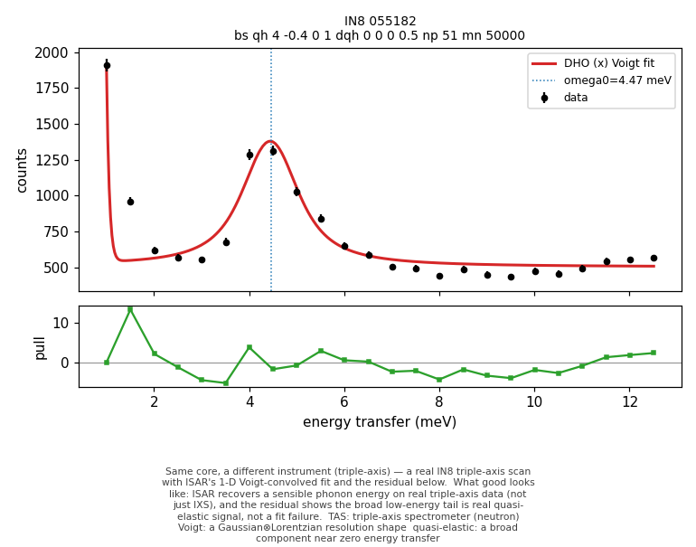

# IN8 cross-check — does the same engine work on a different instrument (triple-axis)?

ISAR's synthetic fitting core was stress-tested on real ILL IN8 triple-axis (TAS) scans and on an APS S30 (IXS) positive control — does the same engine that passes on synthetic data also recover a sensible phonon energy on real data from a different instrument class? A development check on old data. **On TAS the pass condition is a sensible ω₀, not Γ** — ISAR's 1-D resolution omits the 4-D triple-axis focusing, so every TAS Γ here is resolution-contaminated and only means 'did it converge'.

## What this shows

- **Recovers ω₀ on real triple-axis data:** 4.4715 ± 0.025 meV on the clean anchor 055182, matching the hand-vetted ~4.2 meV phonon.
- **The broad low-energy tail is real signal, not resolution:** the elevated cost/dof traces to quasi-elastic / diffuse scattering the elastic+DHO+background model leaves in the residual — so Phase 3 needs a quasi-elastic component, not a wider resolution. (A genuine physics finding from the check.)
- **The same core gives a clean dispersion on IXS:** the S30 control fits 6/6 scans cleanly with a meaningful Γ (resolution measured from the in-window elastic line) — the 'ω trustworthy before Γ on TAS' contrast, made concrete.

## How to read this report

Terms are in `docs/GLOSSARY.md`; the statistics are explained in `docs/STATS_PRIMER.md`.

## See it on real triple-axis data

**Same core, a different instrument (triple-axis)** — a real IN8 triple-axis scan with ISAR's 1-D Voigt-convolved fit and the residual below.

*What good looks like:* ISAR recovers a sensible phonon energy on real triple-axis data (not just IXS), and the residual shows the broad low-energy tail is real quasi-elastic signal, not a fit failure.

*Terms:* **TAS** — triple-axis spectrometer (neutron); **Voigt** — a Gaussian⊗Lorentzian resolution shape; **quasi-elastic** — a broad component near zero energy transfer

The other anchors (055181 messy two-feature, 055289 low-T weak) are in `figures/`.

## Setup

- IN8 resolution: **Cooper–Nathans from the numor header** (per scan 0.58–0.58 meV Gaussian FWHM; no vanadium scan exists, so this is the principled value).
- IN8 batch: 17 `bs qh` energy scans fitted; **6 pass assess_success** (055181, 055182, 055186, 055187, 055194, 055196).
- S30 control: 6/6 fscans converge with a finite Γ error.

## Headline

The synthetic core **recovers ω₀ = 4.4715 ± 0.025 meV on the clean IN8 anchor 055182**, matching the hand-vetted ~4.2 meV phonon — first evidence the core recovers ω₀ on real TAS data. On the validated S30 IXS path the *same core* recovers a full phonon dispersion (ω₀ ~5→7 meV with K) with meaningful Γ.

## Anchors

- **055182 clean**: ω₀ = 4.4715 ± 0.025 meV (success=True, cost/dof=21.13, nP_used=24).
- **055181 messy two-feature**: ω₀ = 2.6115 ± 0.0111 meV (success=True, cost/dof=128.89, nP_used=41).
- **055289 low-T weak**: ω₀ = 4.382 ± nan meV (success=False, cost/dof=21.01, nP_used=25).
The **elevated cost/dof on the clean scans** (055182 = 21.13, 055186 = 40.81 at the CN width) is the key physics result: the data has a strong, *broad* falling low-energy tail that a Cooper–Nathans ~0.6 meV elastic line is far too narrow to make; a width sweep only bottoms out (~7) near ~1.5 meV — broader than any plausible resolution. So that tail is **real quasi-elastic / diffuse scattering** (Fe2Mo3O8 is magnetic), which the elastic+DHO+flat-BG model leaves in the residual. ω₀ is recovered regardless.

## What this means for Phase 3

- **Grid IC without a prior** seeds every scan (ω₀=4.4715 meV on 055182, expected ~4.2 — correct); 055181's single-DHO IC can't represent two features, motivating Phase-3 structure enumeration.
- **Off-window elastic:** IN8 is FX=2 (absolute axis) so center=0 is fixed, but the elastic line sits outside the EN≥1 window for most scans — a known soft spot for the IC.
- **MINOS availability is the sparse-data signal:** available for only 6/17 scans; on TAS the discriminator is convergence itself, and the converged scans sit at MINOS/HESSE ratio ~1 (parabolic).

## Repeat reproducibility (A/B pairs)

The clean A/B test is per-scan repeat pairs (identical commands):
- 055289 (nP 25) ω₀=4.382 vs 055294 (nP 25) ω₀=4.4415
- 055290 (nP 12) ω₀=5.5252 vs 055295 (nP 12) ω₀=6.7683
- 055291 (nP 25) ω₀=5.5849 vs 055296 (nP 25) ω₀=4.4265
- 055292 (nP 12) ω₀=5.7862 vs 055297 (nP 12) ω₀=5.0677
The strong-feature pair (055289/055294) reproduces ω₀ to ~0.08 meV; the weaker and sparse pairs scatter by 1–2 meV — exactly the low-statistics instability Phase-3 triage must flag.

## Caveats

> ⚠ **Caveat —** **TAS Γ is throwaway here.** With no vanadium scan, ISAR's 1-D resolution can't separate the instrumental width from the intrinsic Γ on triple-axis, so every TAS Γ is resolution-limited. The IXS control (resolution measured from the elastic line) is where Γ is meaningful — a property of the data available, not a fit failure.

Per-scan numbers are in `results_in8.csv` / `results_s30.csv` / `results_in8_merged.csv`.
