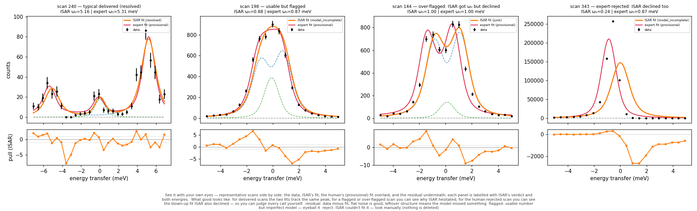
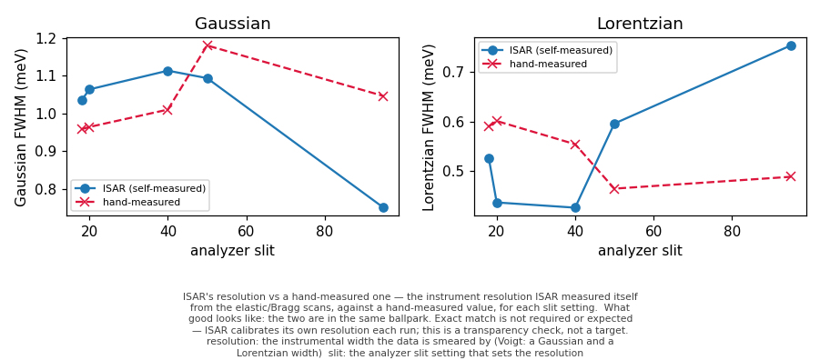
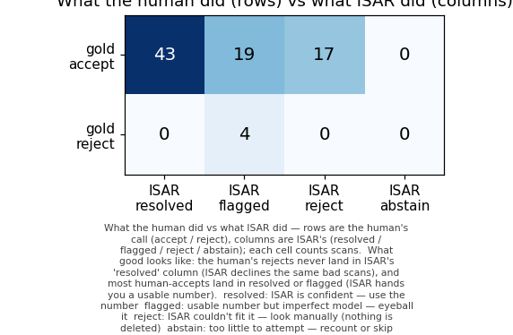
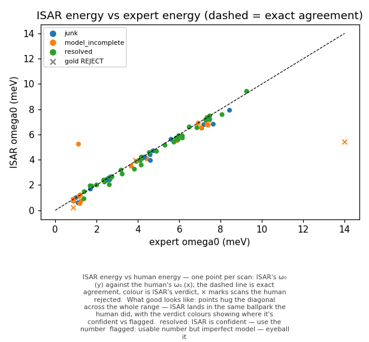
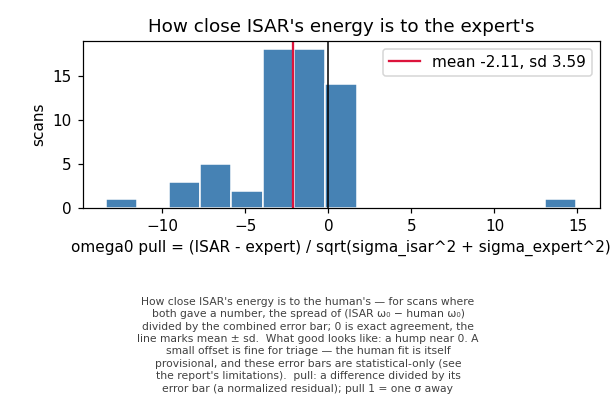
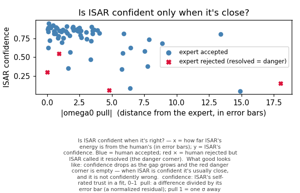

# Gold check — does ISAR make sensible first-pass calls on real data?

ISAR ran its full automatic pipeline (find the structure → fit → error bars → model selection → verdict) on **83 real FeSe scans**, and we compared each call against a human expert's by-hand fits (79 the expert accepted, 4 the expert rejected). This is a *reasonableness and safety* check on old data — part of development, not a live experiment.

## What this checks — and what it does NOT claim

ISAR is a triage tool: a good-enough first pass that flags the hard scans for you, not a replacement for your own analysis. The bar here is three things: (1) **safety** — never hand you a confident number on a scan the expert threw out; (2) **good-enough recovery** — energies land in the right ballpark; (3) **honest confidence** — more sure when it is closer. It is explicitly NOT trying to reproduce the expert exactly: the expert's fits are themselves provisional (they may be revised), and over-tuning to one dataset would make ISAR worse on the next experiment, not better.

## Triage summary — what ISAR did for you

- **Delivered a usable energy for 62 of 79** expert-accepted scans (43 resolved outright, 19 flagged as usable-but-imperfect).
- **Flagged or declined 17** expert-accepted scans for your eyes — nothing deleted, just steered to the manual pile.
- **Safety: 0** expert-rejected scans were confidently resolved by ISAR (target 0) .
Read that as a morning at the beamline: instead of fitting all 83 scans by hand, you'd start with ~62 already fitted plus a short flagged list to eyeball — and you can trust it didn't quietly accept a bad one.

## See it with your own eyes

Representative scans chosen by rule (not cherry-picked): a typical delivered scan, a usable-but-flagged one, one ISAR over-flagged (it actually got the energy right), and one the expert rejected. Data, ISAR's fit, the expert's reconstructed (provisional) fit, and the residual:

**See it with your own eyes** — representative scans side by side: the data, ISAR's fit, the human's (provisional) fit overlaid, and the residual underneath; each panel is labelled with ISAR's verdict and both energies.

*What good looks like:* for delivered scans the two fits track the same peak; for a flagged or over-flagged scan you can see why ISAR hesitated; for the human-rejected scan you can see the blown-up fit ISAR also declined — so you can judge every call yourself.

*Terms:* **residual** — data minus fit; flat noise is good, leftover structure means the model missed something; **flagged** — usable number but imperfect model — eyeball it; **reject** — ISAR couldn't fit it — look manually (nothing is deleted)

## How to read this report

Verdicts and statistics terms are defined in `docs/GLOSSARY.md`; why ISAR uses these methods — and what the error bars do and don't mean — is in `docs/STATS_PRIMER.md`.

## Energy zero — ISAR self-calibrates (the technique, not the numbers)

ISAR fit **111** dedicated K=0 Bragg (`herixE`) elastic scans from the raw `.spec` itself, built a scan-number-keyed zero series, and interpolated the zero to each phonon scan — no expert energy-zero values were used. Scans with no Bragg zero in coverage (so held for calibration): **0**.

## Resolution — ISAR measures its own, cross-checked

**ISAR's resolution vs a hand-measured one** — the instrument resolution ISAR measured itself from the elastic/Bragg scans, against a hand-measured value, for each slit setting.

*What good looks like:* the two are in the same ballpark. Exact match is not required or expected — ISAR calibrates its own resolution each run; this is a transparency check, not a target.

*Terms:* **resolution** — the instrumental width the data is smeared by (Voigt: a Gaussian and a Lorentzian width); **slit** — the analyzer slit setting that sets the resolution

## What the human did vs what ISAR did

**What the human did vs what ISAR did** — rows are the human's call (accept / reject), columns are ISAR's (resolved / flagged / reject / abstain); each cell counts scans.

*What good looks like:* the human's rejects never land in ISAR's 'resolved' column (ISAR declines the same bad scans), and most human-accepts land in resolved or flagged (ISAR hands you a usable number).

*Terms:* **resolved** — ISAR is confident — use the number; **flagged** — usable number but imperfect model — eyeball it; **reject** — ISAR couldn't fit it — look manually (nothing is deleted); **abstain** — too little to attempt — recount or skip

| expert \ ISAR | resolved | flagged | reject | abstain | total |
| --- | --- | --- | --- | --- | --- |
| accept (OK) | 43 | 19 | 17 | 0 | 79 |
| reject (REJECT) | 0 | 4 | 0 | 0 | 4 |

"Delivered" = resolved + flagged (ISAR handed you a usable number); reject / abstain mean "look here yourself".

## How close ISAR's energies are to the expert's

**ISAR energy vs human energy** — one point per scan: ISAR's ω₀ (y) against the human's ω₀ (x); the dashed line is exact agreement, colour is ISAR's verdict, × marks scans the human rejected.

*What good looks like:* points hug the diagonal across the whole range — ISAR lands in the same ballpark the human did, with the verdict colours showing where it's confident vs flagged.

*Terms:* **resolved** — ISAR is confident — use the number; **flagged** — usable number but imperfect model — eyeball it

**How close ISAR's energy is to the human's** — for scans where both gave a number, the spread of (ISAR ω₀ − human ω₀) divided by the combined error bar; 0 is exact agreement, the line marks mean ± sd.

*What good looks like:* a hump near 0. A small offset is fine for triage — the human fit is itself provisional, and these error bars are statistical-only (see the report's limitations).

*Terms:* **pull** — a difference divided by its error bar (a normalized residual); pull 1 = one σ away

- recovery scans (both gave a number, expert-accepted): **62**
- median |Δω₀|: **0.160 meV** (instrument resolution is ~1 meV)
- pull mean / sd: -2.107 / 3.590 — large because the error bars are too tight; see Honest limitations.

## Is ISAR confident when it's right?

**Is ISAR confident when it's right?** — x = how far ISAR's energy is from the human's (in error bars); y = ISAR's confidence. Blue = human accepted; red × = human rejected but ISAR called it resolved (the danger corner).

*What good looks like:* confidence drops as the gap grows and the red danger corner is empty — when ISAR is confident it's usually close, and it is not confidently wrong.

*Terms:* **confidence** — ISAR's self-rated trust in a fit, 0–1; **pull** — a difference divided by its error bar (a normalized residual); pull 1 = one σ away

- confidence when resolved & close vs resolved & far: **0.760** vs **0.264** (higher-when-closer is what we want).

## ISAR verdict buckets

- resolved: 43
- model_incomplete: 23
- junk: 17

## The expert-rejected scans (the safety test)

The expert rejected these as blown-up fits (railed damping/energy, huge χ²). ISAR must decline them too — never `resolved`.

| scan | sample | expert ω₀ | expert χ² | ISAR verdict | ISAR conf | what ISAR did |
| --- | --- | --- | --- | --- | --- | --- |
| 82 | 1 | 14.0 | 18.4919 | model_incomplete | 0.55 | flagged |
| 343 | 2 | 0.865802 | 79617.3906 | model_incomplete | 0.15 | flagged |
| 361 | 2 | 3.862297 | 847.8999 | model_incomplete | 0.06 | flagged |
| 382 | 2 | 0.854052 | 13.6764 | model_incomplete | 0.30 | flagged |

## The recovered energy doesn't come from the prior

Each scan fit with a dispersion prior built from the OTHER expert fits, vs no prior at all. The energy barely moves — so the agreement above is the data talking, not the prior steering ISAR toward the expert's answer.

| scan | ω₀ (with prior) | ω₀ (no prior) | Δω₀ |
| --- | --- | --- | --- |
| 76 | 1.689 | 1.689 | -0.0000 |
| 78 | 3.184 | 3.184 | 0.0000 |
| 80 | 4.708 | 4.708 | -0.0000 |
| 84 | 7.471 | 7.471 | -0.0001 |
| 108 | 1.203 | 1.203 | -0.0001 |
| 110 | 2.557 | 2.557 | -0.0001 |

Worst shift from toggling the prior: **0.0001 meV**.

## Honest limitations (read these)

> ⚠ **Caveat —** **The error bars are statistical-only.** ISAR's 68% intervals contain the expert's value only 0.177 of the time (a calibrated 68% interval would be ~0.68). They capture counting noise, not systematics (background shape, resolution, zero drift), so they are too tight. For triage that's fine — use the energy as a ballpark and look manually before quoting an uncertainty; don't weight by these σ. A systematics-aware error model is future work.

> ⚠ **Caveat —** **`junk` over-fires — in the safe direction.** On some low-K scans ISAR recovers the right energy but its automatic fit leaves a structureless residual, so the runs-test parks the scan in `junk` (your manual pile) instead of delivering it. You lose a little automation, not a number — and nothing is deleted. A planned refinement (require no significant peak before calling junk) would move these into the flagged tier.

> ⚠ **Caveat —** **The expert reference is provisional.** A small systematic offset between ISAR and the expert is expected and isn't necessarily ISAR being wrong — these are old data the owner may re-analyze. Exact agreement is not the goal.

## Sanity gate (safety + good-enough recovery + confidence)

- [PASS] **safety (no clean resolve on a gold-REJECT)** — 0 violations [] (<= 0)
- [PASS] **recovery accuracy: median |dOmega0| (meV)** — 0.160 meV on 62 delivered-OK (<= 0.4)
- [PASS] **confidence calibration (delivered-correct > delivered-wrong)** — 0.760 > 0.264

**PASS**
This gate is a development sanity check on old data, not a production guarantee.
