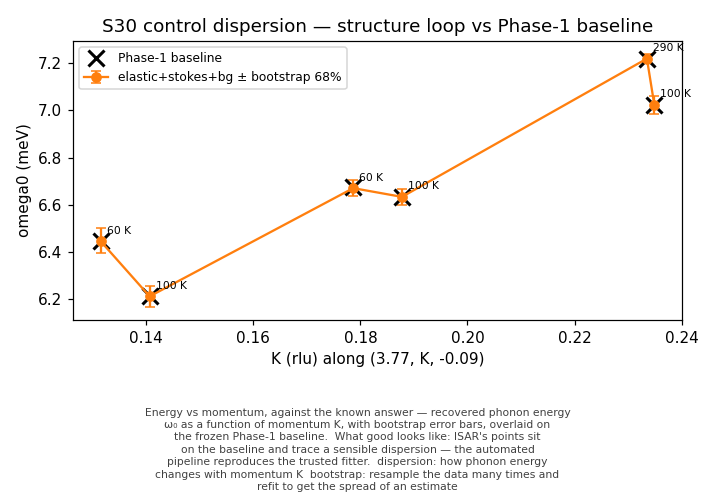
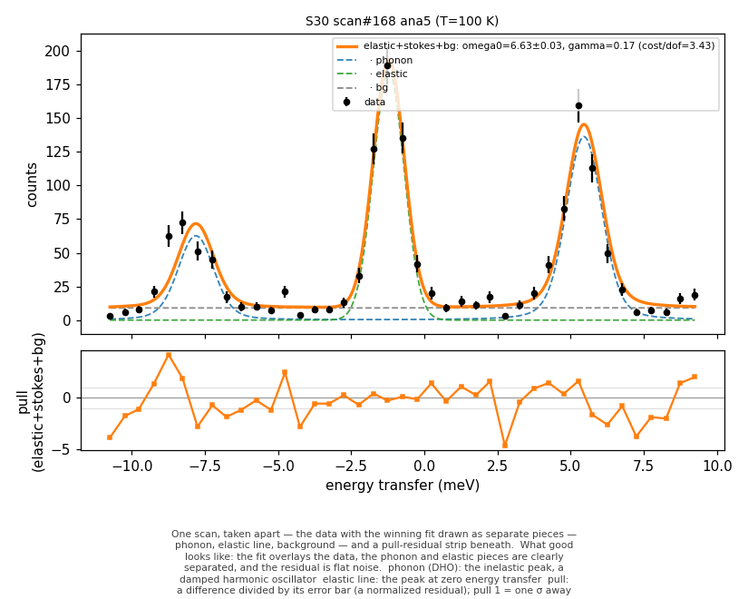
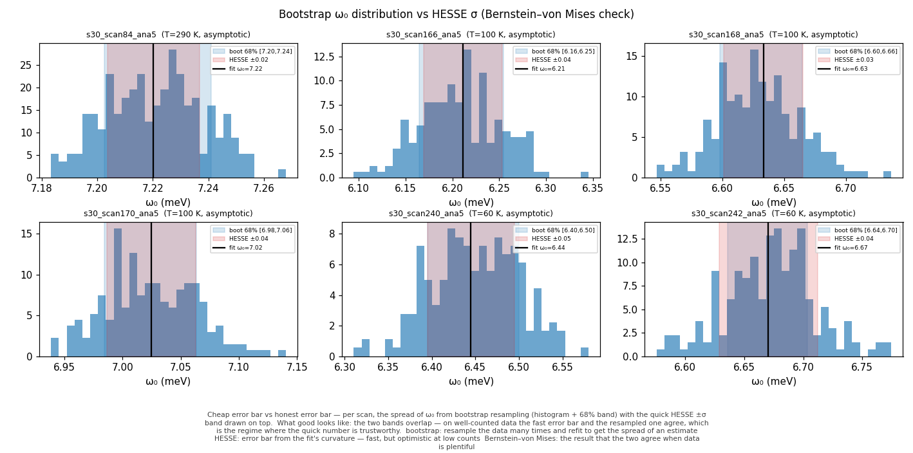
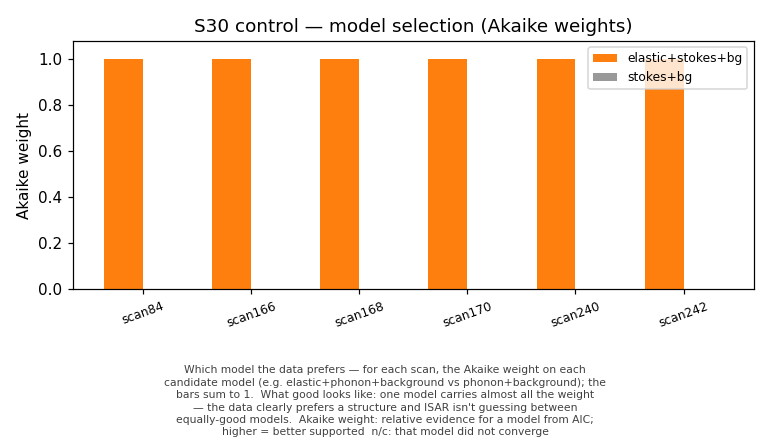
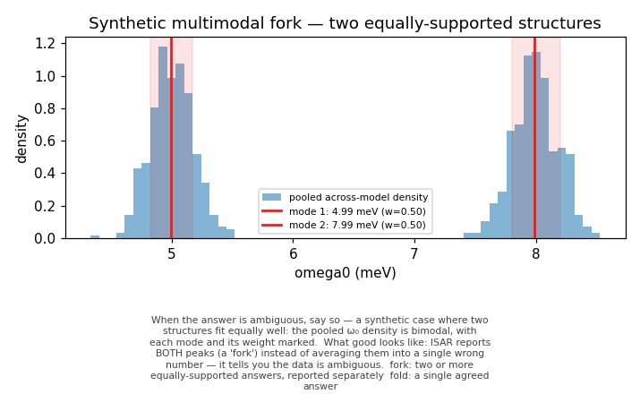
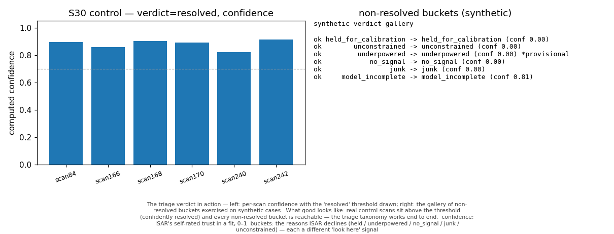
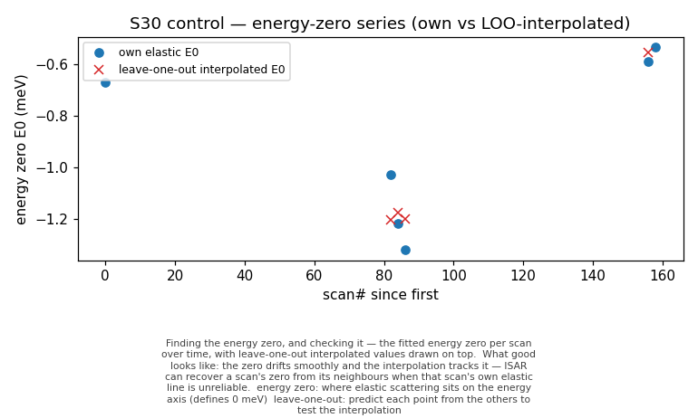

# Control check — does ISAR's engine reproduce the trusted fitter, and stay honest?

ISAR's automatic pipeline (structure loop → fit → bootstrap error bars → model selection → verdict) was run on six FeSeS_1 S30 (IXS) control scans (Q=(3.77, K, −0.09), analyzer ana5) and checked two ways: does it **reproduce the trusted hand-fitter** on the same data, and does its **honesty machinery** behave? A development check on old data — reproduce with `python docs/phase3_step1_check.py`.

## What this shows

- **Reproduces the trusted fitter:** worst |Δω₀| = 0.0048 meV, worst |ΔΓ| = 0.0147 meV vs the frozen Phase-1 baseline — same model, data, and backend.
- **Honest error bars:** the resampled (bootstrap) interval and the quick (HESSE) one agree on these well-counted scans, so the fast number is trustworthy here.
- **Picks the right model:** the data clearly prefer elastic+phonon+background; ISAR isn't guessing between models.
- **Sorts scans into triage verdicts:** all six resolve cleanly; every non-resolved bucket is exercised on synthetic cases so you can see what a decline looks like.

## How to read this report

Terms are in `docs/GLOSSARY.md`; the statistics (Baker–Cousins, bootstrap, AIC, Bernstein–von Mises) are explained for a manual-tools user in `docs/STATS_PRIMER.md`.

## Energy vs momentum — does it match the known answer?

**Energy vs momentum, against the known answer** — recovered phonon energy ω₀ as a function of momentum K, with bootstrap error bars, overlaid on the frozen Phase-1 baseline.

*What good looks like:* ISAR's points sit on the baseline and trace a sensible dispersion — the automated pipeline reproduces the trusted fitter.

*Terms:* **dispersion** — how phonon energy changes with momentum K; **bootstrap** — resample the data many times and refit to get the spread of an estimate

The selected hypothesis reproduces the frozen Phase-1 fitter (worst |Δω₀| = 0.0048 meV, worst |ΔΓ| = 0.0147 meV vs `out/in8_phase1/results_s30.csv`). Cost/dof separates the models: elastic+stokes+bg 1.91–3.59 vs stokes+bg 15.89–32.92.

## One scan, taken apart

**One scan, taken apart** — the data with the winning fit drawn as separate pieces — phonon, elastic line, background — and a pull-residual strip beneath.

*What good looks like:* the fit overlays the data, the phonon and elastic pieces are clearly separated, and the residual is flat noise.

*Terms:* **phonon (DHO)** — the inelastic peak, a damped harmonic oscillator; **elastic line** — the peak at zero energy transfer; **pull** — a difference divided by its error bar (a normalized residual); pull 1 = one σ away

Each control scan's fit, broken into phonon + elastic + background with a pull residual (all six are in `figures/`).

## Authoritative error — bootstrap vs HESSE (Bernstein–von Mises)

**Cheap error bar vs honest error bar** — per scan, the spread of ω₀ from bootstrap resampling (histogram + 68% band) with the quick HESSE ±σ band drawn on top.

*What good looks like:* the two bands overlap — on well-counted data the fast error bar and the resampled one agree, which is the regime where the quick number is trustworthy.

*Terms:* **bootstrap** — resample the data many times and refit to get the spread of an estimate; **HESSE** — error bar from the fit's curvature — fast, but optimistic at low counts; **Bernstein–von Mises** — the result that the two agree when data is plentiful

| scan | T (K) | omega0 | bootstrap 68% | HESSE sigma | boot/HESSE | regime |
|---|---|---|---|---|---|---|
| s30_scan84_ana5 | 290 | 7.220 | [7.202, 7.241] | 0.017 | 1.158 | asymptotic |
| s30_scan166_ana5 | 100 | 6.211 | [6.165, 6.254] | 0.042 | 1.068 | asymptotic |
| s30_scan168_ana5 | 100 | 6.633 | [6.598, 6.665] | 0.032 | 1.044 | asymptotic |
| s30_scan170_ana5 | 100 | 7.024 | [6.984, 7.063] | 0.038 | 1.033 | asymptotic |
| s30_scan240_ana5 | 60 | 6.445 | [6.395, 6.500] | 0.050 | 1.049 | asymptotic |
| s30_scan242_ana5 | 60 | 6.670 | [6.636, 6.703] | 0.042 | 0.804 | asymptotic |
Bootstrap/HESSE in 0.80–1.16 (≈1) on these well-counted scans; all regime=asymptotic (the resampled and curvature error bars agree). The reported ω₀ error is the bootstrap interval; HESSE is a convergence check. The synthetic coverage gate `tests/analyze/test_bootstrap_coverage.py` confirms the 68% interval covers truth ≈68%.

## Which model the data prefer

**Which model the data prefers** — for each scan, the Akaike weight on each candidate model (e.g. elastic+phonon+background vs phonon+background); the bars sum to 1.

*What good looks like:* one model carries almost all the weight — the data clearly prefers a structure and ISAR isn't guessing between equally-good models.

*Terms:* **Akaike weight** — relative evidence for a model from AIC; higher = better supported; **n/c** — that model did not converge

| scan | T (K) | elastic weight | stokes+bg dAIC | nested LRT p | modality | folded omega0 68% |
|---|---|---|---|---|---|---|
| s30_scan84_ana5 | 290 | 1.000 | 517 | 7.0e-115 | fold | [7.202, 7.241] |
| s30_scan166_ana5 | 100 | 1.000 | 746 | 9.2e-165 | fold | [6.164, 6.255] |
| s30_scan168_ana5 | 100 | 1.000 | 931 | 6.0e-205 | fold | [6.598, 6.665] |
| s30_scan170_ana5 | 100 | 1.000 | 962 | 1.3e-211 | fold | [6.984, 7.063] |
| s30_scan240_ana5 | 60 | 1.000 | 613 | 8.7e-136 | fold | [6.394, 6.500] |
| s30_scan242_ana5 | 60 | 1.000 | 795 | 2.4e-175 | fold | [6.635, 6.703] |
Selection is by AIC (Akaike weights; `cost` is Baker–Cousins −2lnL, so AIC = cost + 2k). elastic+stokes+bg is the lone survivor (weight ~1); where stokes+bg converged, the nested likelihood-ratio test confirms the elastic component (p ≪ 1e-3). The pooled ω₀ distribution is unimodal → **fold**. `n/c` = stokes+bg did not converge.

## When the answer is ambiguous — a fork (synthetic)

**When the answer is ambiguous, say so** — a synthetic case where two structures fit equally well: the pooled ω₀ density is bimodal, with each mode and its weight marked.

*What good looks like:* ISAR reports BOTH peaks (a 'fork') instead of averaging them into a single wrong number — it tells you the data is ambiguous.

*Terms:* **fork** — two or more equally-supported answers, reported separately; **fold** — a single agreed answer

- omega0 is either 4.99 or 7.99 meV (weights 0.50/0.50); re-measure to separate.
  - mode 1: omega0 = 4.99 meV, weight 0.50, 68% [4.82, 5.17]
  - mode 2: omega0 = 7.99 meV, weight 0.50, 68% [7.80, 8.20]
The control set is single-phonon (one survivor → fold), so the fork is shown on a synthetic two-structure disagreement (ω₀ at ~5 and ~8 meV): ISAR reports both peaks instead of averaging into the gap.

## The triage verdict + confidence

**The triage verdict in action** — left: per-scan confidence with the 'resolved' threshold drawn; right: the gallery of non-resolved buckets exercised on synthetic cases.

*What good looks like:* real control scans sit above the threshold (confidently resolved) and every non-resolved bucket is reachable — the triage taxonomy works end to end.

*Terms:* **confidence** — ISAR's self-rated trust in a fit, 0–1; **buckets** — the reasons ISAR declines (held / underpowered / no_signal / junk / unconstrained) — each a different 'look here' signal

| scan | T (K) | verdict | confidence | prior omega0 (LOO) |
|---|---|---|---|---|
| s30_scan84_ana5 | 290 | resolved | 0.894 | 6.995 |
| s30_scan166_ana5 | 100 | resolved | 0.860 | 6.437 |
| s30_scan168_ana5 | 100 | resolved | 0.904 | 6.745 |
| s30_scan170_ana5 | 100 | resolved | 0.892 | 7.155 |
| s30_scan240_ana5 | 60 | resolved | 0.823 | 6.146 |
| s30_scan242_ana5 | 60 | resolved | 0.913 | 6.651 |
Each scan gets a named verdict (never deleted) and a [0,1] confidence (geometric mean of sub-scores: structure agreement, interval tightness, regime, prior distance, provenance). A leave-one-out dispersion prior (a line through the other five points) exercises the prior-distance term. All six control scans are **resolved**.

The control set never leaves *resolved*, so every other bucket — and the detection-power circularity guard — is exercised on synthetic cases:

| expected bucket | classified | confidence | note |
|---|---|---|---|
| held_for_calibration | held_for_calibration | 0.00 |  |
| unconstrained | unconstrained | 0.00 |  |
| underpowered | underpowered | 0.00 | provisional (guard) |
| no_signal | no_signal | 0.00 |  |
| junk | junk | 0.00 |  |
| model_incomplete | model_incomplete | 0.81 |  |
`underpowered` is *provisional* (it never marks a region confirmed-empty); `model_incomplete` keeps a structured residual out of `junk`.

## Energy-zero calibration

**Finding the energy zero, and checking it** — the fitted energy zero per scan over time, with leave-one-out interpolated values drawn on top.

*What good looks like:* the zero drifts smoothly and the interpolation tracks it — ISAR can recover a scan's zero from its neighbours when that scan's own elastic line is unreliable.

*Terms:* **energy zero** — where elastic scattering sits on the energy axis (defines 0 meV); **leave-one-out** — predict each point from the others to test the interpolation

S30 needs an energy zero from the elastic line. ISAR builds a time-keyed zero series and interpolates: a scan without a usable elastic borrows a neighbour's zero; a scan with none is held-for-calibration (never E0=0). The control scans each have their own elastic (so the regression Δ is unchanged); the table is a leave-one-out diagnostic.

| scan | scan# | own E0 | LOO-interp E0 | residual |
|---|---|---|---|---|
| s30_scan84_ana5 | 0 | -0.668 | n/a | n/a |
| s30_scan166_ana5 | 82 | -1.025 | -1.204 | -0.178 |
| s30_scan168_ana5 | 84 | -1.217 | -1.172 | +0.044 |
| s30_scan170_ana5 | 86 | -1.319 | -1.199 | +0.120 |
| s30_scan240_ana5 | 156 | -0.588 | -0.555 | +0.033 |
| s30_scan242_ana5 | 158 | -0.533 | n/a | n/a |
LOO interpolation residual is loose (max |Δ| = 0.18 meV): these six control zeros are sparse and not smoothly drifting — interpolation is a fallback for missing-elastic scans, not a replacement for a present one.

- **Interpolated zero feeds the loop:** a no-elastic scan (true zero -0.60 meV) resolves its zero from the series (`source=interpolated`) and still recovers omega0 = 7.99 meV (true 8.0).
- **Missing zero is held, never E0=0:** a scan with no series coverage → `held_for_calibration`.

## Scope / caveats

> ⚠ **Caveat —** This control set is well-counted, in-window-elastic, single-phonon, own-elastic-zero — so everything here resolves cleanly. The harder paths (sparse regime, fork, the non-resolved buckets, interpolated/held zeros) are exercised by the synthetic demos and the unit tests, not by these six scans.

Per-(scan, hypothesis) numbers — status flags, intervals, AIC/weights, verdict + confidence — are in `results_step1.csv`.
